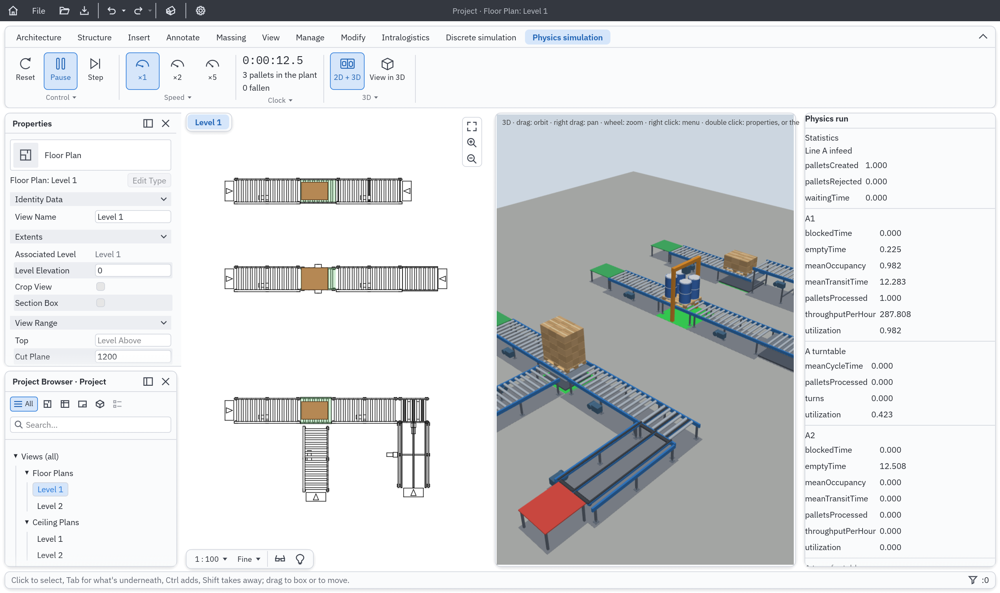

<p align="center">
  
</p>

<h1 align="center">IntraCraft</h1>

<p align="center">
  <b>Design and simulate pallet conveyor systems: one layout, a fast discrete-event run and a real-time physics run.</b>
</p>

<p align="center">
  Place roller and chain conveyors, turntables, transfers, lifts, sensors and stops on a floor plan, connect them port to
  port, and run the same plant two ways: as a discrete-event simulation, far faster than real time, for throughput,
  accumulation and blocking; and as a 3D physics simulation, in real time, for friction, impacts, pallet alignment and
  sensors with real geometry. Simulate before you build.<br>
  <i>Built on <a href="https://github.com/IPedrax/BIMCraft">BIMCraft</a>, the open-source BIM application by IPedrax.</i>
</p>

<p align="center">
  
  
  
  
  
</p>

<br>

<p align="center">
  
  <br><sub><b>The mixed example plant</b> in the Physics simulation module, floor plan and 3D run side by side
  (<code>scripts/intracraft-demo-physics.cmd</code>).</sub>
</p>

<p align="center">
  <a href="#why-intracraft">Why IntraCraft</a> ·
  <a href="#three-modules-one-project">Three modules</a> ·
  <a href="#the-object-library">The object library</a> ·
  <a href="#intrascript">IntraScript</a> ·
  <a href="#quick-start">Quick start</a> ·
  <a href="#project-files">Project files</a> ·
  <a href="#repository-layout">Repository layout</a> ·
  <a href="#documentation">Documentation</a> ·
  <a href="#credits">Credits</a> ·
  <a href="#license">License</a>
</p>

## Why IntraCraft

- **One layout, two simulations.** The plant you draw in the Design module is the only source of truth. The discrete
  run and the physics run both read it, and the same If/Then controller drives both: the same control logic on two
  models of the same plant.
- **Fast where it can be, real where it must be.** Event-driven simulation answers throughput and blocking questions in
  seconds; rigid-body physics answers what a discrete model cannot: does the pallet stop within ±5 mm of the stop, does
  it skew on the transfer, when does the sensor really see it.
- **Checked against the numbers.** Analytic reference tests (a 3 m run from rest, the maximum throughput of a line, a
  90° turn, a transfer cycle, the energy of an impact) must agree within 1 %, and a sensor's events in the discrete and
  physics runs within ±50 ms. Same layout and same seed give the same result, every time.
- **A real BIM project underneath.** Conveyors are families with types and instance parameters, an attribute table that
  shows what each object inherits, schedules, plans, sections, a 3D view and sheets: everything BIMCraft does.
- **Everything is a command.** Every change to a project goes through a typed command with undo, so a script, the
  command line or an agent can do what the window does.

## Three modules, one project

| Module                  | What it does                                                                                       | Answers                                    |
| ----------------------- | -------------------------------------------------------------------------------------------------- | ------------------------------------------ |
| **Design**              | The BIM editor: place library objects with port-to-port snapping, edit their property sheet        | What the plant is and what it is made of   |
| **Discrete simulation** | A 2D event-driven run of the layout, far faster than real time                                     | Throughput, accumulation, blocking, usage  |
| **Physics simulation**  | A 3D rigid-body run in real time (Avian), beside the plan or in a 3D window of its own (Bevy)      | Friction, impacts, alignment, real sensors |

The modules are tabs on BIMCraft's ribbon. Both runs can be watched in 2D and 3D at once, and every placed object has a
statistics sheet.

## The object library

Each object is a parametric definition (parameters with unit, range, default and description; ports; signals; geometry;
validation; presets) with a 2D behaviour, a 3D behaviour, a control template, a reference scenario and tests.

- **Conveyors:** roller conveyor, chain conveyor, chain turntable, roller turntable, roller-to-chain transfer.
- **Lifts and gravity:** manual lift table, scissor lift table, two-level pallet elevator (rollers or chains), gravity
  roller line with separator.
- **Detection and guidance:** photoelectric sensors (diffuse, retroreflective, through-beam), fixed and retractable
  mechanical stops, side guides with a funnel.
- **Flow:** pallet source and sink, process station; EUR/EPAL and other pallet types, with loads.
- **Logic:** an If/Then rule controller, and the code block for IntraScript.

Default values in the specifications are indicative only; they are not manufacturer data.

## IntraScript

A small programming language with Python's syntax for plant logic, run by IntraCraft's own sandboxed, deterministic
interpreter. Events are decorators, waits and units are built in:

```python
@on_enter(Line_A)
def hold(pallet):
    Line_A.run = False
    wait(2 * s)          # two seconds of simulated time; the rest of the plant goes on
    Line_A.run = True
```

Units are checked: `150 * mm` is a length, `0.25 * m / s` a speed, and adding a length to a time stops the run with a
message that says so.

It runs in the discrete simulation today. Reference: [A17 IntraScript Language](docs/en/app/A17%20IntraScript%20Language.md);
tutorial: [A20 IntraScript Tutorial](docs/en/app/A20%20IntraScript%20Tutorial.md).

## Quick start

You need a stable Rust toolchain. Every Rust dependency is vendored in `platform/vendor`, so the build needs no network.

```sh
cd platform
cargo run --release -p intracraft                                    # an empty project
cargo run --release -p intracraft -- ../examples/layouts/mixed-plant.intracraft.json --module physics --play --split
cargo build --release -p intracraft -p intracraft-viewer             # with the separate 3D window ("View in 3D")
```

On Windows, double-click one of the launchers in `scripts/`: `intracraft.cmd` (drop a project on it to open it),
`intracraft-demo-discrete.cmd`, `intracraft-demo-physics.cmd`, `intracraft-viewer-demo.cmd` and
`intracraft-pallet-drop.cmd`.

Seven example plants are in [`examples/layouts`](examples/layouts): an accumulation line, a roller-to-chain transfer, a
chain line with a turntable, turntable distribution, a mezzanine with an elevator and a gravity line, a mixed plant, and
pallets dropping off an open end.

From a terminal, without a window:

```sh
cargo run -p intracraft-cli -- code check LAYOUT.intracraft.json CODE.py   # check IntraScript code against a layout
cargo run -p intracraft-cli -- code run LAYOUT.intracraft.json --seconds 600
cargo test --workspace                                                # every test, BIMCraft's and IntraCraft's
```

## Project files

- **`.intracraft`** is an IntraCraft project: what File > Save As writes. It is a BIMCraft project file (JSON with a
  format version, migrated when an older one is opened) holding the plant as families and instances.
- **`.bimcraft`** projects open as well, and so do IFC files, as in BIMCraft.
- **`.intracraft.json`** is a layout of the TypeScript reference implementation; opening one places it in a new
  project.

## Repository layout

```text
intracraft/
├─ platform/          BIMCraft (git subtree) with IntraCraft on top: a Cargo workspace
│  ├─ crates/         BIMCraft: core, ui-egui, i18n, update, rvt, dwg (changes listed in INTRACRAFT-CHANGES.md)
│  ├─ sim/            IntraCraft: library, model, des, control, physics, avian, assets, scene, script, scenarios, ui
│  ├─ apps/           intracraft, intracraft-cli, intracraft-viewer (and BIMCraft's own apps)
│  └─ vendor/         the sources of every Rust dependency
├─ docs/              theory (T), architecture (A), one specification per object (S), decisions (ADR); en/ is the reference
├─ examples/          example plants
├─ brand/             IntraCraft's logo, colours and guidelines
├─ packages/, apps/   the first implementation, in TypeScript, frozen as the reference the Rust version must match
└─ test_data/         saved results and test data
```

## Documentation

The docs are an Obsidian vault; start at [docs/en/Home (EN).md](docs/en/Home%20(EN).md).

- [A01 Product Overview](docs/en/app/A01%20Product%20Overview.md) and [A02 Architecture](docs/en/app/A02%20Architecture.md)
- [A19 Rust Implementation Plan](docs/en/app/A19%20Rust%20Implementation%20Plan.md): the phases and where they stand
- [Specifications](docs/en/specs): one per library object, from S01 Roller Conveyor to S22 Area
- [Decisions](docs/en/decisions): why the platform, the physics engine and the language are what they are
- [AGENTS.md](AGENTS.md): the working rules for anyone, person or agent, changing the code

## Credits

**IntraCraft stands on [BIMCraft](https://github.com/IPedrax/BIMCraft)** by **IPedrax and the BIMCraft contributors**: a
clean-room, pure-Rust BIM application following the Revit workflow. The whole Design module, the window, the ribbon, the
plans, sections, 3D view, schedules and sheets, the project file, the command engine with undo, the translations and the
way an agent drives the program are BIMCraft's work. IntraCraft adds its simulation crates and apps beside it and keeps
every change it makes to BIMCraft's own files listed, with the reason, in
[platform/INTRACRAFT-CHANGES.md](platform/INTRACRAFT-CHANGES.md). This README's shape is borrowed from
[BIMCraft's](platform/README.md) too. Thank you, IPedrax.

BIMCraft is brought in as a git subtree in `platform/` and is licensed MIT OR Apache-2.0
([LICENSE-MIT](platform/LICENSE-MIT), [LICENSE-APACHE](platform/LICENSE-APACHE)); its notices are in
[platform/NOTICE](platform/NOTICE). Physics runs on [Avian](https://github.com/Jondolf/avian) and the 3D window on
[Bevy](https://bevyengine.org); the interface is [egui](https://github.com/emilk/egui). The full list of third-party work
and licences is in [ATTRIBUTION.md](ATTRIBUTION.md).

IntraCraft is clean-room: no code, files or assets of commercial simulation programs are read, copied or imported, and
no third-party names or logos are used in the product.

## License

IntraCraft's own code (`platform/sim/`, `platform/apps/intracraft*`) is licensed MIT OR Apache-2.0, like BIMCraft. Each
vendored dependency keeps its own licence; see [ATTRIBUTION.md](ATTRIBUTION.md).
