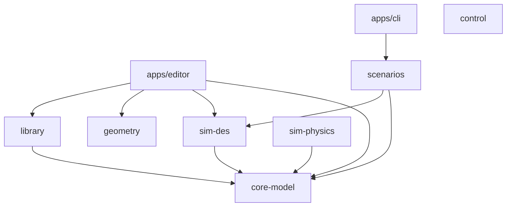
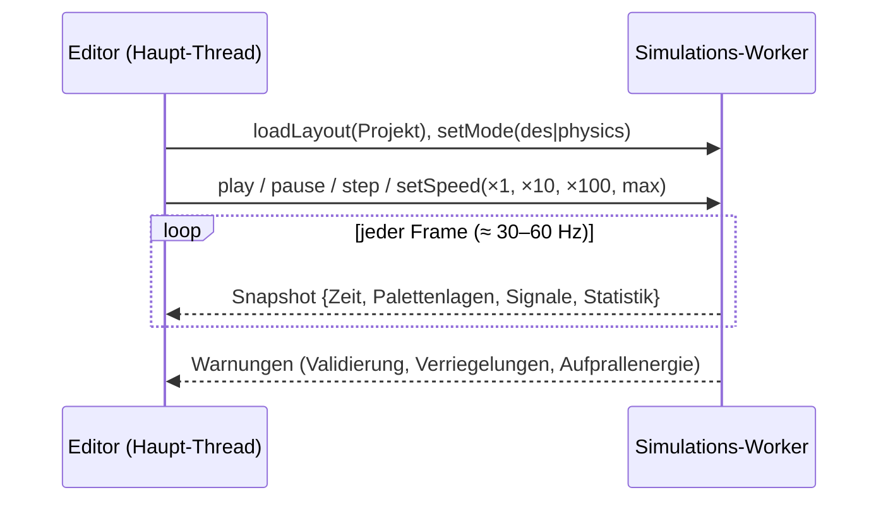

🌐 [[A02 Architecture|EN]] · [[A02 Arquitectura|ES]] · **DE** · [[Startseite (DE)|Index]]

# A02 Architektur

## 1. Schichten

| Schicht       | Paket         | Verantwortung                                                                | Abhängig von                              |
| ------------- | ------------- | ---------------------------------------------------------------------------- | ----------------------------------------- |
| Modell        | `core-model`  | Einheiten, Zeit, Seed-Generator, Logger, Projekt-/Layoutschema, Validierung  | zod                                       |
| Bibliothek    | `library`     | Komponentendefinitionen (JSON), Referenzdaten, Validierungsregeln, Registry  | core-model, zod                           |
| Geometrie     | `geometry`    | Parametrische Anordnung von Rollen, Ketten, Rahmen (reine Zahlen)            | —                                         |
| DES-Engine    | `sim-des`     | Ereigniswarteschlange, Simulationsschleife, analytische Kinematik, Statistik | core-model                                |
| Physik-Engine | `sim-physics` | Backend-Schnittstelle, Festschritt-Uhr, geschlossene Mechanikformeln         | core-model (+ Jolt/Rapier nach S1)        |
| Steuerung     | `control`     | Boolesche Signale und Wenn/Dann-Regeln                                       | —                                         |
| Szenarien     | `scenarios`   | Referenzszenarien und erwartete Ergebnisse                                   | core-model, sim-des                       |
| Editor        | `apps/editor` | Oberfläche, 2D/3D-Viewer, Eigenschafts- und Bibliotheksbereich               | React, react-three-fiber, Zustand, Pakete |
| CLI           | `apps/cli`    | Führt Szenarien ohne Oberfläche aus                                          | scenarios                                 |

**Feste Regel:** `sim-des`, `sim-physics` und `control` importieren nie React, three.js oder das DOM und rufen nie `Math.random()` auf. ESLint erzwingt beides.

## 2. Abhängigkeitsgraph



## 3. Laufzeit: UI-Thread und Simulations-Worker



- Die Simulation (2D oder 3D) läuft in einem **Web Worker**, damit die Oberfläche nie einfriert.
- Die Oberfläche erhält nur **Snapshots**; sie ändert den Simulationszustand nie direkt.
- 3D: fester Physikschritt (1/120 s) mit Akkumulator; der Viewer interpoliert ([[T10 Zeitintegration und fester Zeitschritt]]).
- 2D: Die Uhr springt zwischen Ereignissen; der Viewer wertet das kinematische Segment jeder Palette zur Framezeit aus ([[T02 Ereignisdiskrete Simulation]]).
- Snapshots sollen übertragbare Typed Arrays (Positionen, Quaternionen) nutzen, um Kopierkosten zu vermeiden – umzusetzen in Phase 3/4.

## 4. Vom Layout zur laufenden Anlage

1. Die Projektdatei wird gelesen und validiert (`projectSchema`, [[A04 Datenmodell und Projektdatei]]).
2. Die Definition jeder Instanz wird aus der Registry geholt ([[A05 Komponentenbibliothek]]).
3. Der Modus baut seine Anlage: Der DES-Modus instanziiert `behaviors.des` der Definition, der Physikmodus `behaviors.physics`.
4. Verbindungen koppeln Ausgangs- mit Eingangsports; die Steuerung wird an die Signale gebunden.
5. Starten.

## 5. Verhaltensvertrag (geplant)

```ts
interface ComponentBehavior<P> {
  readonly id: string;
  init(ctx: SimContext, params: P): void;
  onEvent?(ctx: DesContext, event: SimEvent): void;   // 2D-Modus
  step?(ctx: PhysicsContext, dt: number): void;       // 3D-Modus
  readSignals(): Record<string, boolean>;             // Ausgänge zur Steuerung
  writeSignals(inputs: Record<string, boolean>): void;
  statistics(): Record<string, number>;
}
```

Die Daten (JSON) beschreiben, **was** eine Komponente ist; registrierte TypeScript-Verhalten setzen um, **wie** sie sich verhält. Oberfläche und Validierungen entstehen aus den Daten, die Logik liegt in getesteten Modulen.

## 6. KI-Agenten

Jede Zustandsänderung läuft über eine Befehlsschicht, die Oberfläche, CLI, ein MCP-Server und ein integrierter Chat gemeinsam nutzen; Lesezugriffe laufen über eine Abfrageschicht. Vorerst nur Entwurf: [[A15 KI-Agenten-Integration]] und [[ADR-0004 Befehlsschicht und MCP für KI-Agenten]].

## Verwandt

[[A03 Monorepo und Stack]] · [[A06 DES-Engine]] · [[A07 Physik-Wrapper]] · [[A08 Steuerung]] · [[A09 Editor und Viewer]]
