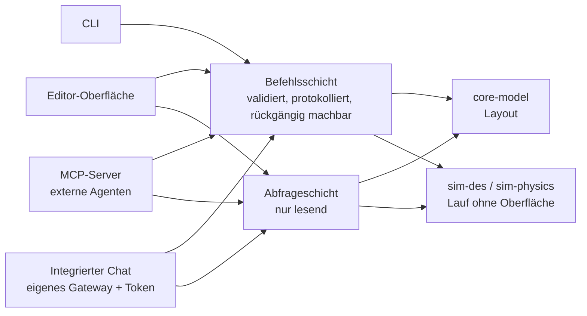

🌐 [[A15 AI Agent Integration|EN]] · [[A15 Integración con agentes de IA|ES]] · **DE** · [[Startseite (DE)|Index]]

# A15 KI-Agenten-Integration (nur Entwurf – nicht umgesetzt)

**Anforderung (Projektverantwortlicher, 29.10.2026):** IntraCraft muss von Anfang an so angelegt sein, dass KI-Agenten damit arbeiten können – **direkt** verbunden oder über einen **MCP-Server**. Wie in anderen Werkzeugen des Verantwortlichen (z. B. SolidCraft) soll die Anwendung eine integrierte Möglichkeit bieten, **eigenes LLM-Gateway und eigenen API-Token** einzutragen und per Chat mit der Anwendung zu sprechen und sie zu steuern. **Noch wird nichts entwickelt; diese Notiz legt die Architektur fest, damit der ab Phase 2 geschriebene Code nicht umgebaut werden muss.** Entscheidung: [[ADR-0004 Befehlsschicht und MCP für KI-Agenten]].

## 1. Die eine Regel, die es möglich macht: alles ist ein Befehl

Jede Aktion, die das Projekt oder die Simulation verändert, läuft über eine einzige **Befehlsschicht** – egal, wer sie auslöst: Editor-Oberfläche, CLI, MCP-Client oder integrierter Chat.

| Eigenschaft          | Regel                                                                                                              |
| -------------------- | ------------------------------------------------------------------------------------------------------------------ |
| Typisiert            | Jeder Befehl hat einen Namen und ein Zod-Eingabeschema; daraus entsteht auch das JSON Schema des Agenten-Werkzeugs |
| Validiert            | Eingaben werden vor der Ausführung geprüft; Bibliotheksregeln (3 Rollen, Breiten …) liefern Warnungen              |
| Atomar               | Ein Befehl gelingt vollständig oder ändert nichts                                                                  |
| Rückgängig machbar   | Bearbeitungsbefehle erzeugen ihr Gegenstück; ein Agenten-Zug = eine Rückgängig-Gruppe                              |
| Protokolliert        | Befehlsprotokoll mit Akteur (`user`, `cli`, `mcp:<client>`, `chat`), Zeit, Eingabe und Ergebnis                    |
| Deterministisch      | Abspielen des Protokolls auf demselben Projekt + Seed ergibt dasselbe Projekt und dieselben Ergebnisse             |
| Keine reine UI-Logik | Was die Oberfläche kann, kann ein Befehl (der Eigenschaftsbereich ruft `layout.setParams` auf)                     |

Abfragen (nur lesend) sind von Befehlen getrennt: Agenten dürfen frei inspizieren, Änderungen laufen immer über Befehle.

## 2. Entwurf des Befehls- und Abfragekatalogs

| Name                                      | Art              | Recht                   | Zweck                                                                         |
| ----------------------------------------- | ---------------- | ----------------------- | ----------------------------------------------------------------------------- |
| `project.new` / `.open` / `.save`         | Befehl           | Bearbeiten / Datei      | Lebenszyklus der Projektdatei (`.intracraft.json`)                            |
| `library.list` / `.get`                   | Abfrage          | Lesen                   | Definitionen, Parameter (Einheiten, Bereiche, Auswahlwerte), Voreinstellungen |
| `layout.get`                              | Abfrage          | Lesen                   | Instanzen, Parameter, Verbindungen                                            |
| `layout.addInstance`                      | Befehl           | Bearbeiten              | Definition mit Position, Drehung und Parametern platzieren                    |
| `layout.setParams`                        | Befehl           | Bearbeiten              | Parameter einer Instanz ändern (z. B. Höhe der Lichtschranke)                 |
| `layout.move`                             | Befehl           | Bearbeiten              | Position / Drehung                                                            |
| `layout.connect` / `.disconnect`          | Befehl           | Bearbeiten              | Portverbindungen (mit Ausrichtungswarnungen)                                  |
| `layout.remove`                           | Befehl           | Bearbeiten (bestätigen) | Instanzen löschen                                                             |
| `layout.validate`                         | Abfrage          | Lesen                   | Alle Validierungsmeldungen                                                    |
| `sim.setMode`                             | Befehl           | Ausführen               | 2D (DES) oder 3D (Physik); startet den Lauf neu                               |
| `sim.run` / `.step` / `.pause` / `.reset` | Befehl           | Ausführen               | Bis zu einer Zeit oder Bedingung laufen, mit Geschwindigkeit                  |
| `sim.snapshot`                            | Abfrage          | Lesen                   | Zeit, Palettenlagen, Signale                                                  |
| `results.statistics` / `.eventLog`        | Abfrage          | Lesen                   | Kennzahlen je Objekt, Ereignisspur (CSV/JSON)                                 |
| `scenario.list` / `.run`                  | Abfrage / Befehl | Ausführen               | Referenzszenarien (T1–T6 …)                                                   |

Alle Werte an dieser Schnittstelle in SI-Einheiten (wie in der Projektdatei); die Werkzeuge nennen die Einheiten in ihrer Beschreibung, damit ein Modell nie mm und m verwechselt.

## 3. Weg A — MCP-Server (externe Agenten)

Am 29.10.2026 gegen die offizielle Spezifikation geprüft (Revision **2026-07-28**):

- Nachrichten sind **JSON-RPC 2.0**; die Revision 2026-07-28 ist **zustandslos** (keine Protokollsitzungen; jede Anfrage trägt Version und Fähigkeiten selbst).
- Standardtransporte: **stdio** (der Client startet den Server als Unterprozess) und **Streamable HTTP** (jede Nachricht ist ein HTTP-POST an einen Endpunkt; Antworten als JSON oder anfragebezogener SSE-Strom). Der alte HTTP+SSE-Transport ist veraltet.
- Serverfunktionen: **Tools** (vom Modell ausgeführte Funktionen), **Resources** (Kontext/Daten), **Prompts** (Vorlagen). Clientfunktion: **Elicitation**. Optionale Erweiterungen: **Tasks** (lang laufende Vorgänge mit Abfrage – passend für `sim.run` über Stunden Anlagenzeit) und **MCP Apps** (eingebettete Oberfläche).
- Sicherheitsprinzipien der Spezifikation: ausdrückliche Zustimmung des Benutzers vor Datenzugriff und Werkzeugaufruf; Werkzeugbeschreibungen nicht vertrauenswürdiger Server sind nicht vertrauenswürdig.
- Offizielles TypeScript-SDK: `@modelcontextprotocol/sdk` (1.32.2, MIT).

**Geplante Zuordnung.**

| MCP-Primitiv | IntraCraft                                                                                                                                                                    |
| ------------ | ----------------------------------------------------------------------------------------------------------------------------------------------------------------------------- |
| Tools        | Befehle und Abfragen aus §2 (JSON Schema aus den Zod-Schemas erzeugt)                                                                                                         |
| Resources    | `intracraft://project`, `intracraft://library/{id}`, `intracraft://results/{run}`, `intracraft://docs/{lang}/{note}` – Agenten können die Spezifikationen dieses Vaults lesen |
| Prompts      | Vorlagen wie „baue eine Linie von Quelle bis Senke“, „finde den Engpass“, „prüfe dieses Layout“                                                                               |
| Tasks (Erw.) | Lange Simulationsläufe mit Fortschritt und Abbruch                                                                                                                            |

**Bereitstellung.** Eine neue Anwendung `apps/mcp-server` (Node) mit denselben Paketen wie die CLI: Sie öffnet eine Projektdatei und rechnet die Engines ohne Oberfläche. **Zuerst stdio** (für Desktop-Agenten-Hosts); **später Streamable HTTP**, nur an `127.0.0.1` gebunden, mit Token, Origin-Prüfung und standardmäßig ohne Fernzugriff. Ein laufender Editor wird später mit dem Server synchronisiert (Dateiüberwachung oder lokaler WebSocket); die Desktop-Version (Tauri) kann den Server als Begleitprozess betreiben.

## 4. Weg B — integrierter Chat mit eigenem Gateway und Token

Ein Chatbereich im Editor, in dem der Benutzer mit der Anwendung spricht. Der Editor ist der **Agenten-Host**: Er sendet den Gesprächsverlauf und die Werkzeugdefinitionen (§2) an ein Sprachmodell und führt die vom Modell gelieferten Werkzeugaufrufe über die Befehlsschicht aus.

**Einstellungen (je Benutzer, nie je Projekt):**

| Einstellung  | Beispiel / Hinweis                                                         |
| ------------ | -------------------------------------------------------------------------- |
| API-Stil     | Zu verwendender Adapter (erster geplanter Adapter: Anthropic Messages API) |
| Gateway-URL  | Basis-URL des Anbieters oder des LLM-Gateways/Proxys der Firma             |
| API-Token    | Schlüssel oder Bearer-Token für dieses Gateway                             |
| Modell       | Freitext mit Standardwert (Anthropic-Adapter: `claude-opus-5-5`)           |
| Berechtigung | nur lesen · Layout bearbeiten · bearbeiten + Simulationen ausführen        |

**Anbieterunabhängiger Entwurf.** Eine Schnittstelle `LlmAdapter` (Nachrichten + Werkzeugdefinitionen senden, Text und Werkzeugaufrufe empfangen) hält die übrige Anwendung unabhängig vom Anbieter. Jeder Anbieter bekommt einen eigenen Adapter auf Basis seines offiziellen SDK; der erste geplante nutzt `@anthropic-ai/sdk` (1.3.0, Apache-2.0) mit der Option `baseURL`, die auf das eingestellte Gateway zeigt.

**Hinweise für den Anthropic-Adapter (geprüft am 29.10.2026):**

- Werkzeuge werden mit `name`, `description` und `input_schema` (JSON Schema) definiert; `strict: true` setzen, damit Argumente immer schemakonform sind.
- Das Modell kann in einem Zug mehrere Werkzeuge anfordern: ausführen und **alle** Ergebnisse in einer einzigen Benutzernachricht zurückgeben; fehlgeschlagene Werkzeuge liefern ein Ergebnis mit `is_error: true` (nie weglassen).
- Immer `stop_reason` prüfen (`tool_use`, `end_turn`, `max_tokens`, `refusal`), bevor der Inhalt gelesen wird.
- Ein bestimmtes Werkzeug zu erzwingen (`tool_choice` `any`/`tool`) lehnen die neuesten Modelle ab: `auto` verwenden und im Systemprompt sagen, welche Werkzeuge zu nutzen sind.
- Für lange Antworten Streaming nutzen; jede Werkzeugeingabe vor der Ausführung validieren, auch mit `strict`.
- Der eigene Remote-MCP-Connector der API braucht einen aus dem Internet erreichbaren Server und passt daher **nicht** zu einer lokalen Anwendung; der integrierte Chat ruft die Befehle lokal auf.

**Token-Sicherheit.** In der Desktop-Version im Schlüsselbund des Betriebssystems; in der lokalen Web-Version standardmäßig nur im Speicher der Sitzung (optional Browser-Speicher mit deutlicher Warnung). Nie in der Projektdatei, in Logs, Ereignisspuren oder exportierten Ergebnissen; in Fehlermeldungen geschwärzt.

## 5. Sicherheit und Kontrolle (beide Wege)

1. **Zustimmung und Bestätigung** — zerstörende oder lange Aktionen (`layout.remove`, Überschreiben bei `project.save`, langes `sim.run`) fragen den Benutzer, wie es die MCP-Spezifikation für Werkzeugaufrufe verlangt.
2. **Berechtigungsstufen** — neue Agenten standardmäßig nur lesend; der Benutzer erweitert.
3. **Grenzen** — höchste Zahl Werkzeugaufrufe je Zug und höchste Simulationszeit je Anfrage.
4. **Sichtbarkeit** — der Chat zeigt jeden Aufruf und sein Ergebnis; das Befehlsprotokoll kennzeichnet Agentenaktionen.
5. **Rückgängig** — ein Klick macht einen ganzen Agenten-Zug rückgängig.
6. **Nicht vertrauenswürdige Daten** — Instanznamen, Beschreibungen und importierte Dateien sind Daten, nie Anweisungen an den Agenten (Schutz vor Prompt-Injection).

## 6. Phasen

| Phase (siehe [[A12 Phasenplan]]) | KI-bezogenes Ergebnis                                                                                       |
| -------------------------------- | ----------------------------------------------------------------------------------------------------------- |
| 2 — Kern und Bibliothek          | Befehls- und Abfrageschicht mit Zod-Schemas, Befehlsprotokoll, Rückgängig; die Oberfläche nutzt nur Befehle |
| 3 — Rollenförderer 2D            | Lauf ohne Oberfläche, gemeinsam für CLI und künftigen MCP-Server                                            |
| Nach 3 (MVP oder direkt danach)  | `apps/mcp-server` über stdio; Tools/Resources/Prompts aus §2–3                                              |
| Nach dem MVP                     | Integrierter Chat mit eigenem Gateway + Token; Streamable HTTP; MCP-Tasks                                   |

## Verwandt

[[ADR-0004 Befehlsschicht und MCP für KI-Agenten]] · [[A02 Architektur]] · [[A10 CLI und Szenarien]] · [[A13 Konventionen]]
