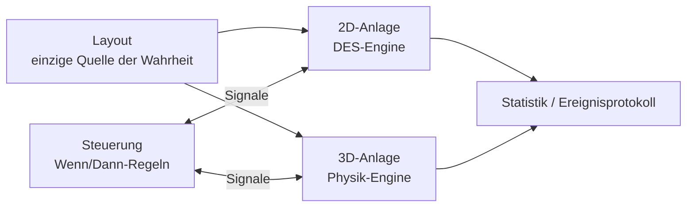

🌐 [[T01 Simulation Paradigms|EN]] · [[T01 Paradigmas de simulación|ES]] · **DE** · [[Startseite (DE)|Index]]

# T01 Simulationsparadigmen

## 1. Was ein Simulationsmodell ist

Ein Simulationsmodell beschreibt den **Zustand** eines Systems und die **Regeln**, die diesen Zustand über die **Zeit** verändern. Bei einer Palettenförderanlage ist der Zustand zum Beispiel: wo jede Palette steht, wie schnell sie sich bewegt, welche Sensoren belegt sind, welche Anschläge oben sind und was jeder Antrieb tut.

Modelle werden üblicherweise nach vier Achsen eingeteilt:

| Achse            | Option A                        | Option B                            | IntraCraft                                               |
| ---------------- | ------------------------------- | ----------------------------------- | -------------------------------------------------------- |
| Zeitabhängigkeit | Statisch (ohne Zeit)            | Dynamisch (Zustand entwickelt sich) | Dynamisch                                                |
| Zufall           | Deterministisch                 | Stochastisch (zufällige Eingaben)   | Beides: Zufallseingaben aus einem Generator **mit Seed** |
| Zeitbasis        | Kontinuierliche Zeit            | Diskrete Zeit (Schritte)            | 2D: kontinuierlich, ereignisgesteuert · 3D: Schritte     |
| Zustandswechsel  | Kontinuierlich (z. B. Position) | Diskret (z. B. Sensor ein/aus)      | Gemischt                                                 |

## 2. Die drei relevanten Familien

### 2.1 Ereignisdiskrete Simulation (DES)

Man nimmt an, dass sich der Zustand nur zu abzählbar vielen Zeitpunkten ändert, den **Ereignissen** (eine Palette fährt ein, die Vorderkante erreicht einen Sensor, ein Drehtisch beendet die Drehung). Zwischen zwei Ereignissen passiert nichts „Interessantes“, daher **springt** der Simulator die Uhr direkt zum nächsten Ereignis. Deshalb kann der 2D-Modus 1000-mal schneller als Echtzeit laufen: Eine Fahrt von 12 s braucht oft nur 3–4 Ereignisse.

Kerngedanke bei Förderern: Positionen ändern sich zwischen Ereignissen *durchaus* kontinuierlich, folgen aber bekannten Formeln (konstante Beschleunigung oder konstante Geschwindigkeit). Die Engine speichert diese Formeln als **kinematische Segmente** und wertet sie nur bei Bedarf aus – um das nächste Ereignis vorherzusagen oder den Viewer zu animieren. Siehe [[T02 Ereignisdiskrete Simulation]] und [[T04 Kinematik von Förderern]].

### 2.2 Zeitschrittverfahren (kontinuierliche Simulation)

Das Modell ist ein System von Differentialgleichungen $\dot{x} = f(x, t)$, das mit einem Schritt $\Delta t$ integriert wird. Alles wird in jedem Schritt neu berechnet, ob etwas passiert oder nicht. Der Aufwand wächst mit simulierter Zeit / $\Delta t$, nicht mit der Zahl der Ereignisse.

### 2.3 Starrkörper-Physiksimulation

Ein spezielles Zeitschrittverfahren: Die Gleichungen sind die Newton-Euler-Gleichungen starrer Körper plus **Zwangsbedingungen** (Kontakte, Reibung, Gelenke), die in jedem Schritt gelöst werden. Sie bildet Effekte ab, die keine Formel des 2D-Modus enthält: Schlupf auf Rollen, Rückprall am Anschlag, eine Palette, die sich an einem außermittigen Anschlag verdreht, ein Einlauftrichter, der eine schräge Palette ausrichtet, eine Kette, die in einen Hohlraum der Palette fällt. Siehe [[T09 Starrkörperdynamik]] bis [[T14 Anschläge, Aufprall und Ausrichtung]].

## 3. Warum ein Produkt zwei Paradigmen nutzt

| Frage                                                   | Bester Modus | Warum                                                |
| ------------------------------------------------------- | ------------ | ---------------------------------------------------- |
| Wie viele Paletten pro Stunde schafft dieser Kreislauf? | 2D (DES)     | Braucht Stunden simulierter Zeit und viele Läufe     |
| Wo entstehen Staus und wie lange dauern sie?            | 2D (DES)     | Statistik über lange Läufe                           |
| Hält die Palette ±5 mm vor dem Anschlag?                | 3D (Physik)  | Hängt von Reibung, Masse und Restitution ab          |
| Wird eine um 50 mm / 5° verschobene Palette korrigiert? | 3D (Physik)  | Hängt von der Kontaktgeometrie ab                    |
| Flackert die Lichtschranke durch die Palettenhohlräume? | Beide        | 2D nutzt das Belegungsprofil, 3D die reale Geometrie |
| Ist die Steuerungslogik korrekt?                        | Beide        | Dieselbe Steuerung bedient beide Anlagenmodelle      |

**Geschwindigkeit vs. Genauigkeit.** Der 2D-Modus zielt auf ≥ 1000× Echtzeit bei 50 Objekten und 30 Paletten; der 3D-Modus auf Echtzeit (60 FPS) bei 20 Förderern und 10 Paletten, mit einem festen Physikschritt von 1/120 s.

Beispiel – T1 (3 m, 0,25 m/s, 0,5 m/s²): Der 2D-Modus berechnet die Ankunft bei 12,25 s mit einer geschlossenen Formel und **einem** geplanten Ereignis. Der 3D-Modus braucht $12{,}25 \times 120 = 1470$ Physikschritte und löst in jedem alle Kontakte Rolle–Brett.

## 4. Die hybride Architektur

1. **Das Layout ist die Quelle der Wahrheit.** Beide Anlagenmodelle werden daraus *abgeleitet*.
2. **Gleiche Steuerungslogik, andere Anlage.** Die Steuerung sieht nur boolesche Signale (Sensoren rein, Aktoren raus). Sie weiß nicht, ob sie mit einem abstrakten Modell oder mit Physik spricht – dieselbe Idee wie bei der *virtuellen Inbetriebnahme*. Siehe [[T07 Steuerungslogik und Signale]].
3. **Ein Moduswechsel startet die Simulation neu** (MVP); Zustandsübergabe mitten im Lauf kommt nach dem MVP.
4. **Konsistenz wird gemessen**, nicht angenommen: Durchlaufzeiten innerhalb ±5 % und Sensorflanken innerhalb ±50 ms zwischen den Modi. Abweichungen fließen in die Kalibrierung ein. Siehe [[T16 Hybride Konsistenz und Kalibrierung]].

## 5. Häufige Fehler

- Den 2D-Modus als „ungenaue Physik“ betrachten. Er ist für seine Annahmen *exakt* (kein Schlupf, ideale Anschläge); seine Grenzen sind die Annahmen, nicht numerische Fehler.
- Den 3D-Modus als „die Wahrheit“ betrachten. Er ist nur so gut wie Reibung, Masse und Restitution, die bis zur Kalibrierung Richtwerte sind.
- Paradigmen in einer Engine vermischen. IntraCraft hält sie in getrennten Paketen (`sim-des`, `sim-physics`) hinter derselben Steuerung.

## Verwandt

[[T02 Ereignisdiskrete Simulation]] · [[T10 Zeitintegration und fester Zeitschritt]] · [[A02 Architektur]]
