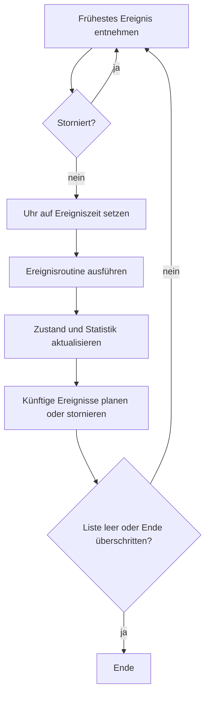

🌐 [[T02 Discrete-Event Simulation|EN]] · [[T02 Simulación de eventos discretos|ES]] · **DE** · [[Startseite (DE)|Index]]

# T02 Ereignisdiskrete Simulation

## 1. Begriffe

| Begriff              | Definition                                              | In IntraCraft                                                                         |
| -------------------- | ------------------------------------------------------- | ------------------------------------------------------------------------------------- |
| Entität              | Objekt, das durch das System fließt                     | Palette                                                                               |
| Ressource / Bediener | Objekt, das Entitäten belegen oder auf das sie warten   | Förderzone, Drehtisch, Kettenumsetzer                                                 |
| Attribut             | Eigenschaft einer Entität                               | Palettentyp, Masse, Ladehöhe, eigene Schlüssel–Werte                                  |
| Zustandsvariable     | Wert, der das System zum Zeitpunkt *t* beschreibt       | Zone belegt, Anschlag oben, Motor läuft                                               |
| Ereignis             | Zeitpunkt, an dem sich der Zustand ändert               | `front_reaches_stop`, `sensor_edge`, `turn_completed`                                 |
| Aktivität            | Intervall zwischen zwei Ereignissen mit bekannter Dauer | 90° drehen (6,5 s), Ketten heben (1 s)                                                |
| Simulationsuhr       | Aktuelle simulierte Zeit                                | Ganzzahlige Mikrosekunden (siehe [[T03 Zeit, Ereignisreihenfolge und Determinismus]]) |
| Ereignisliste        | Geordnete Menge der geplanten Ereignisse                | Binärer Min-Heap `EventQueue`                                                         |

## 2. Fortschreiten zum nächsten Ereignis

Der Kern jeder DES-Engine ist eine Schleife, die immer wieder das **früheste** geplante Ereignis entnimmt, die Uhr auf dessen Zeit setzt und seine **Ereignisroutine** ausführt. Die Routine aktualisiert den Zustand und kann neue Ereignisse planen oder bestehende stornieren.

```text
uhr ← 0
Startereignisse planen (Quellen, Start der Steuerung)
solange Liste nicht leer und nächstes.zeit ≤ ende:
    e ← liste.entnimmMinimum()       # nach (Zeit, Priorität, Sequenz)
    falls e storniert: weiter        # veraltete Vorhersage
    uhr ← e.zeit
    handler[e.typ](e)                # Zustand ändern, planen/stornieren
    e protokollieren                 # Trace → Statistik, Hash
```



Die Uhr läuft nie in kleinen Schritten: Liegt das nächste Ereignis bei 12,25 s, springt sie mit einer einzigen Zuweisung von 0 auf 12,25 s. Simulierte Zeit ist deshalb von der Rechenzeit entkoppelt.

## 3. Modellierungssichten

Drei klassische Arten, DES-Modelle zu schreiben:

1. **Ereignisorientiert** — eine Routine je Ereignistyp (unser Ansatz).
2. **Aktivitätsorientiert** — man schreibt Bedingungen, die Engine prüft nach jedem Ereignis alle.
3. **Prozessorientiert** — jede Entität ist ein Prozess, der „wartet“ (Koroutinen); in kommerziellen Werkzeugen verbreitet.

IntraCraft arbeitet **ereignisorientiert, gegliedert nach Komponenten**: Jedes Bibliotheksverhalten (z. B. `des.roller_conveyor`) behandelt die Ereignisse, die an es gerichtet sind. Die Wenn/Dann-Steuerung ist eine leichte Form der aktivitätsorientierten Sicht und wird nur bei Signaländerungen neu ausgewertet ([[T07 Steuerungslogik und Signale]]).

## 4. Förderer als Bahnen: vorhersagen statt schrittweise rechnen

Ein Förderer wird als **Bahn** modelliert (1D-Koordinate $s$ in Förderrichtung) mit einer geordneten Liste von Paletten. Jede Palette ist ein Intervall $[s_{hinten}, s_{vorn}]$ mit einem aktuellen **kinematischen Segment** $(t_0, s_0, v_0, a)$:

$$s(t) = s_0 + v_0 (t - t_0) + \tfrac{1}{2} a (t - t_0)^2$$

Nach jedem Ereignis **sagt** die Engine für jede betroffene Palette die nächste relevante Überfahrt voraus, indem sie diese quadratische Gleichung für $s(t) = s^\*$ löst – Sensorposition, Anschlag, Zonenende, Hinterkante der vorausfahrenden Palette minus Mindestabstand ([[T04 Kinematik von Förderern]], Funktion `timeToReach`). Nur die früheste Überfahrt wird geplant.

### Veraltete Vorhersagen

Vorhersagen werden falsch, wenn sich vorher etwas ändert – ein Anschlag fährt hoch, ein Motor stoppt, die vordere Palette bremst. Es gibt zwei gleichwertige Techniken:

- **Stornierungstickets** (umgesetzt in `DesSimulator.cancel`): Das Ticket jeder Vorhersage wird gespeichert und storniert; die Warteschlange überspringt es beim Entnehmen.
- **Versionsnummern** (je Palette geplant): Jede Palette trägt eine Version, die bei jeder Bewegungsänderung steigt; ein Ereignis mit abweichender Version wird ignoriert.

Beide vermeiden das teure Entfernen eines beliebigen Elements aus einem Heap.

## 5. Beispiel: eine Palette auf einem 3-m-Rollenförderer mit Sensor

| t (s)  | Ereignis                 | Was die Routine tut                                                                                   |
| ------ | ------------------------ | ----------------------------------------------------------------------------------------------------- |
| 0,000  | `pallet_enters`          | Segment $(0, 0, 0, 0{,}5)$; Ende der Rampe und Sensor vorhersagen                                     |
| 0,500  | `ramp_ends`              | Neues Segment mit $v = 0{,}25$ m/s, $a = 0$                                                           |
| 8,250  | `sensor_edge` (steigend) | Vorderkante bei 2,0 m: $t = 0{,}5 + (2{,}0 - 0{,}0625)/0{,}25$; Signal → Steuerung                    |
| 12,250 | `front_reaches_end`      | Übergabe an den nächsten Förderer über Port B (T1)                                                    |
| 13,050 | `sensor_edge` (fallend)  | Hinterkante passiert 2,0 m (Vorderkante bei 3,2 m): Länge / v = 4,8 s nach der steigenden Flanke (T6) |

Fünf Ereignisse statt tausender Schritte. Der Viewer animiert die Palette zwischen den Ereignissen, indem er $s(t)$ in jedem Frame auswertet – „analytische Interpolation“.

## 6. Gleichzeitige Ereignisse

Zwei Ereignisse können zeitgleich sein (zwei Paletten, die dieselbe Regel freigibt). Dann zählt die Reihenfolge: Wird die Sensorflanke verarbeitet, bevor die Steuerung reagiert? IntraCraft entscheidet Gleichstände mit einer expliziten **Priorität** und danach mit der **Einfügereihenfolge** – das macht das Ergebnis reproduzierbar. Siehe [[T03 Zeit, Ereignisreihenfolge und Determinismus]].

## 7. Geplante Ereignistypen im MVP

`pallet_enters`, `front_reaches_stop`, `tail_clears_entry`, `sensor_edge`, `zone_released`, `turn_completed`, `lift_completed`, `transfer_completed`, `signal_changed`, `rule_fired`.

## 8. Aufwand

Jedes Ereignis kostet $O(\log n)$ im Heap plus die Arbeit der Routine. Durchsatzstudien über Stunden Anlagenzeit brauchen nur Sekunden Rechenzeit – Ziel ist ≥ 1000× Echtzeit bei 50 Objekten und 30 Paletten.

## Verwandt

[[T03 Zeit, Ereignisreihenfolge und Determinismus]] · [[T04 Kinematik von Förderern]] · [[T05 Stau, Kapazität und Durchsatz]] · [[A06 DES-Engine]]
