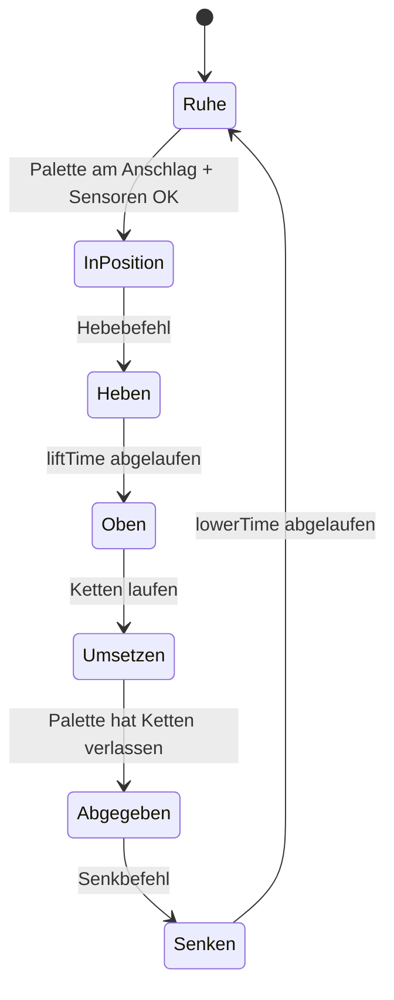

🌐 [[T07 Control Logic and Signals|EN]] · [[T07 Lógica de control y señales|ES]] · **DE** · [[Startseite (DE)|Index]]

# T07 Steuerungslogik und Signale

## 1. Anlage und Steuerung

Eine Förderanlage besteht aus der **Anlage** (Mechanik: Förderer, Anschläge, Sensoren) und der **Steuerung** (in der Realität eine SPS). Beide kommunizieren nur über **Signale**:

- **Eingänge der Steuerung** = Sensorausgänge: `pe1`, `zone2.occupied`, `turntable.atStation`…
- **Ausgänge der Steuerung** = Befehle an Aktoren: `zone1.run`, `stop1.up`, `turntable.goToStation`, `transfer.liftChains`…

IntraCraft hält diese Trennung strikt ein: Dieselbe Steuerung bedient das 2D- und das 3D-Anlagenmodell. Nur so sind 2D/3D-Vergleiche aussagekräftig – und das ist die Grundlage der *virtuellen Inbetriebnahme*.

## 2. Boolesche Signale und Flanken

MVP-Signale sind boolesch. Die Logik hängt oft nicht vom Wert, sondern von seiner **Änderung** ab:

| Flanke   | Definition                    | Typische Verwendung                                        |
| -------- | ----------------------------- | ---------------------------------------------------------- |
| Steigend | vorher = falsch, jetzt = wahr | „Palette am Sensor angekommen“                             |
| Fallend  | vorher = wahr, jetzt = falsch | „Hinterkante hat den Sensor verlassen“ → nächste freigeben |

Eine Flanke existiert nur in einer Auswertung; ein Pegel (`is: true`) gilt, solange der Wert anliegt.

## 3. Wenn/Dann-Regeln

Eine Regel lautet `WENN alle Bedingungen DANN Signale schreiben (optional nach einer Verzögerung)`:

```json
{
  "id": "stop-up-after-pass",
  "when": [{ "signal": "pe1", "edge": "falling" }],
  "then": [{ "signal": "stop1.up", "value": true, "delayMs": 200 }]
}
```

Der Auswerter (`packages/control/src/rules.ts`) ist eine **reine Funktion**: `evaluateRules(regeln, vorher, jetzt) → Schreibvorgänge`. Er liest nie eine Uhr und berührt nie die Anlage; der Aufrufer wendet die Schreibvorgänge an und plant Verzögerungen. Genau diese Reinheit erlaubt es beiden Modi, ihn zu teilen.

### Verzögerungen und Zeitglieder

`delayMs` ist das Zeitglied des MVP: Der Schreibvorgang wirkt später. In 2D wird daraus ein geplantes Ereignis `signal_changed` bei `jetzt + Verzögerung`; in 3D ein ausstehender Schreibvorgang, der im ersten Steuerungszyklus ≥ diesem Zeitpunkt angewendet wird. (Ob ein verzögerter Schreibvorgang entfällt, wenn die Bedingung wegfällt – Einschaltverzögerung –, ist noch festzulegen.)

## 4. Wann werden Regeln ausgewertet?

| Modus | Auswertung                                               | Folge                                                                               |
| ----- | -------------------------------------------------------- | ----------------------------------------------------------------------------------- |
| 2D    | Bei jeder Signaländerung (ereignisgesteuert)             | Exakte Flankenzeiten; keine Abtastverzögerung                                       |
| 3D    | In jedem Steuerungszyklus (Standard 10 ms), wie eine SPS | Bis zu 10 ms Zusatzverzögerung; Flanken kürzer als ein Zyklus können verloren gehen |

Eine SPS arbeitet in einem **Zyklus**: alle Eingänge lesen → Logik ausführen → alle Ausgänge schreiben. Der 3D-Modus bildet das nach. In 2D entspricht die Auswertung bei jeder Änderung einer unendlich schnellen SPS; hängt ein Szenario von der Zykluszeit ab, kann auch der 2D-Modus auf einem 10-ms-Raster auswerten.

**Falle — Impulse kürzer als der Zyklus.** Eine fallende Flanke, auf die innerhalb von 10 ms eine steigende folgt, ist für eine 3D-Steuerung unsichtbar, in 2D aber sichtbar. Besser Sensorfilter nutzen ([[T06 Fotoelektrische Erfassung]]), als sich auf sehr kurze Impulse zu verlassen.

## 5. Verriegelungen

Eine **Verriegelung** ist eine Bedingung, die erfüllt sein muss, bevor eine Aktion erlaubt ist – unabhängig davon, was die Regeln fordern. Sie schützen Anlage und Paletten:

- Drehtisch: nicht drehen, wenn die Palette nicht zentriert ist (`requiresCenteredPallet`) oder eine Palette über die Kante ragt.
- Kettenumsetzer: nicht heben ohne Palette in Position; Rollen stehen, solange die Ketten oben sind; nicht senken, bevor die Palette die Ketten verlassen hat; im bidirektionalen Betrieb nie von beiden Seiten annehmen.

Verriegelungen liegen **im Komponentenverhalten**, nicht in den Benutzerregeln, damit eine falsche Regel das Gerätemodell nicht beschädigen kann. Ein gesperrter Befehl wird als Warnung protokolliert.

## 6. Zustandsautomaten

Komplexe Komponenten laufen als endliche Zustandsautomaten ab. Kettenumsetzer:



In 2D ist jeder Übergang mit bekannter Dauer ein geplantes Ereignis (`lift_completed` nach `liftTime`); in 3D werden dieselben Übergänge ausgelöst, wenn die kinematischen Ketten ihre Zielpositionen erreichen.

## 7. Steuerungsvorlagen im MVP

| Vorlage                                 | Logik in Worten                                                                                  |
| --------------------------------------- | ------------------------------------------------------------------------------------------------ |
| Staudrucklose Förderung (ZPA)           | Zone *i* läuft, solange Zone *i+1* frei ist; hält, wenn beide belegt sind                        |
| Anschlag mit Sensor                     | Anschlag standardmäßig oben; absenken, wenn stromabwärts frei; nach der Hinterkante wieder heben |
| Drehtisch wartet auf zentrierte Palette | Aufnehmen → wenn zentriert: Ketten stoppen → drehen → beruhigen → abgeben                        |
| Umsetzer mit vollständigem Ablauf       | Zustandsautomat aus §6 mit allen Verriegelungen                                                  |

Die ZPA-Vorlage ist in `control/src/rules.test.ts` getestet.

## Verwandt

[[T05 Stau, Kapazität und Durchsatz]] · [[T13 Drehtische und Kettenumsetzer]] · [[A08 Steuerung]]
