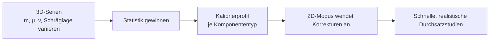

🌐 [[T16 Hybrid Consistency and Calibration|EN]] · [[T16 Consistencia híbrida y calibración|ES]] · **DE** · [[Startseite (DE)|Index]]

# T16 Hybride Konsistenz und Kalibrierung

## 1. Warum sich die Modi überhaupt unterscheiden

Der 2D-Modus ist für eine **ideale** Anlage exakt; der 3D-Modus simuliert eine **nicht ideale**. Unterschiede entstehen durch Effekte, die das 2D-Modell nicht enthält:

| Effekt                      | 2D-Annahme                                           | 3D-Realität                                               |
| --------------------------- | ---------------------------------------------------- | --------------------------------------------------------- |
| Traktion                    | Palettengeschwindigkeit = Oberflächengeschwindigkeit | Mikroschlupf, Schlupf bei niedrigem μ oder steilen Rampen |
| Aufprall am Anschlag        | Sofortiger Halt an der Anschlagposition              | Rückprall, Beruhigen, Verdrehen                           |
| Übergabe zwischen Förderern | Regel (z. B. Minimalgeschwindigkeit)                 | Kontakte auf beiden Förderern, Spalt dazwischen           |
| Drehtisch                   | Palette fest auf der Plattform                       | Leichtes Rutschen beim Beschleunigen                      |
| Sensoren                    | Analytische Flanken                                  | Schrittquantisierte Raycasts, reale Geometrie             |
| Steuerung                   | Ereignisgesteuert (sofort)                           | Alle 10 ms abgetastet                                     |

## 2. Konsistenzkriterien (MVP)

Für jedes Referenzszenario laufen beide Modi und werden verglichen:

| Größe                        | Toleranz |
| ---------------------------- | -------- |
| Durchlaufzeiten              | ±5 %     |
| Zeitpunkte der Sensorflanken | ±50 ms   |

Eine größere Abweichung ist ein **Befund**, nichts zum Verstecken: entweder ein Fehler, eine fehlende Regel in 2D oder ein fehlender Kalibrierparameter. Reibung, Massen oder Zeitschritte werden nie ohne Entscheidungsnotiz angepasst, nur damit die Zahlen passen (AGENTS.md).

## 3. Kalibrierung (nach dem MVP, das Hauptunterscheidungsmerkmal)

**Serien von 3D-Experimenten** mit variierter Masse, Reibung, Einlaufgeschwindigkeit und Schräglage durchführen und Statistiken gewinnen:

- Korrektur der Durchlaufzeit je Förderertyp (z. B. +0,12 s je Anlauf/Halt bei μ = 0,3);
- Wahrscheinlichkeit von Verklemmen / Schräglage außerhalb der Toleranz;
- Verteilung des Endlagefehlers an Anschlägen.

Daraus entstehen **Kalibrierprofile**, die der 2D-Modus anwendet (als Zusatzverzögerungen, Verteilungen oder Störwahrscheinlichkeiten). So gewinnt der 2D-Modus Realismus und behält seine 1000-fache Geschwindigkeit.

## 4. Moduswechsel im laufenden Betrieb (nach dem MVP)

Ein Moduswechsel während des Laufs erfordert die Umrechnung des Zustands zwischen den Welten. Er ist nur in **stabilen Lagen** der Paletten sauber definiert (ruhend oder mit bekannter Geschwindigkeit, nicht mitten im Aufprall). Im MVP startet der Wechsel die Simulation neu.

## Verwandt

[[T01 Simulationsparadigmen]] · [[T06 Fotoelektrische Erfassung]] · [[A11 Tests und Validierung]]
