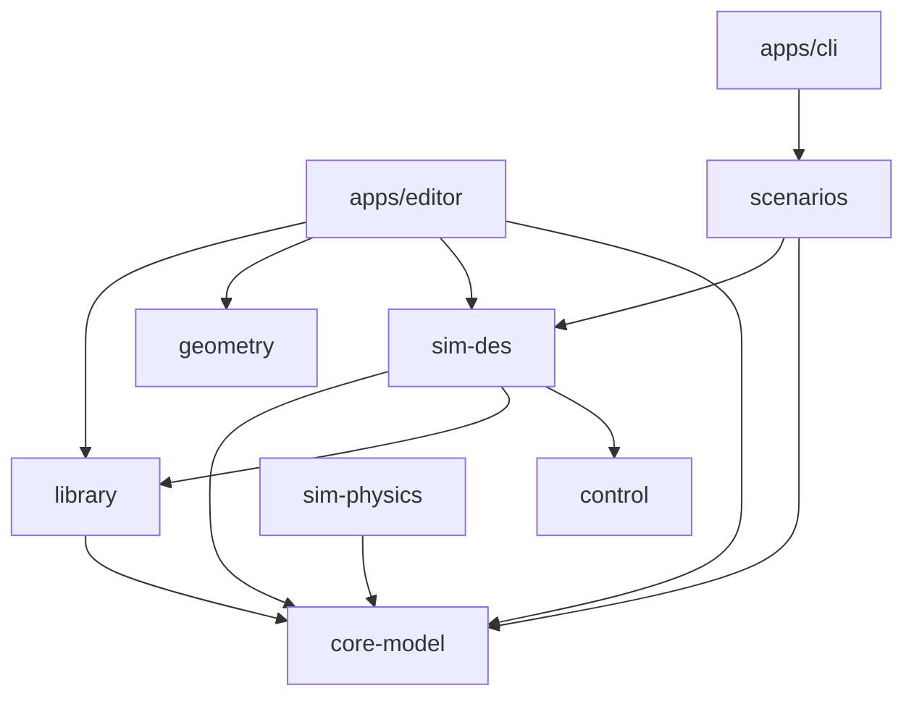
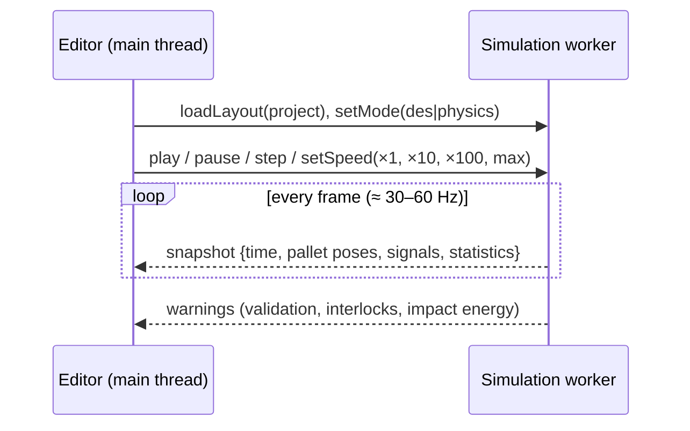

🌐 **EN** · [[A02 Arquitectura|ES]] · [[A02 Architektur|DE]] · [[Home (EN)|Index]]

# A02 Architecture

## 0. The Rust platform (since 2026-10-31)

The product is built in Rust inside BIMCraft ([[ADR-0020 Rust Platform on BIMCraft with Three Modules]]); sections 1–5 describe the TypeScript reference, which the Rust crates follow.

| Layer         | Crate (in `platform/`)                   | Responsibility                                                                                                    | Module                  |
| ------------- | ---------------------------------------- | ----------------------------------------------------------------------------------------------------------------- | ----------------------- |
| BIM model     | `bimcraft-core` (`crates/core`)          | Elements, ids and GUIDs, families, schedules, plans, 3D scene, IFC, commands (`Session::execute`, undo, rollback) | Design                  |
| BIM desktop   | `bimcraft-ui-egui` (`crates/ui-egui`)    | Ribbon, Project Browser, Properties, canvas, 3D view                                                              | Design                  |
| Library       | `intracraft-library` (`sim/library`)     | The JSON definitions and reference data, validation rules, ports, geometric connections                           | all                     |
| Model         | `intracraft-model` (`sim/model`)         | Families from the library, attributes with inheritance, layout and simulation tree read from the BIM model        | Design                  |
| DES engine    | `intracraft-des` (`sim/des`)             | Event queue, kinematics, flow model, stations, photoeyes, statistics                                              | Discrete simulation     |
| Controller    | `intracraft-control` (`sim/control`)     | Boolean signals and If/Then rules                                                                                 | both simulation modules |
| Physics       | `intracraft-physics` (`sim/physics`)     | Rapier world built from the layout, decks, MTBH bodies, raycast sensors                                           | Physics simulation      |
| Scenarios     | `intracraft-scenarios` (`sim/scenarios`) | The reference's scenarios and expected values                                                                     | tests, CLI              |
| Module panels | `intracraft-ui` (`sim/ui`)               | Simulation tree, attribute table, run controls, statistics sheets                                                 | all                     |
| Applications  | `apps/intracraft`, `apps/intracraft-cli` | The desktop with the module selector; scenarios headless                                                          | —                       |

**Hard rules:** the `sim/` crates depend on `bimcraft-core`, never the reverse; the engines (`des`, `control`, `physics`) have no UI dependency and use only the project's seeded random generator; a run never changes the BIM model (snapshots only); the UI changes the model only through commands.

## 1. Layers of the TypeScript reference

| Layer          | Package       | Responsibility                                                           | Depends on                                  |
| -------------- | ------------- | ------------------------------------------------------------------------ | ------------------------------------------- |
| Model          | `core-model`  | Units, time, seeded RNG, logger, project/layout schema, validation       | zod                                         |
| Library        | `library`     | Component definitions (JSON), reference data, validation rules, registry | core-model, zod                             |
| Geometry       | `geometry`    | Parametric layout of rollers, chains, frames (pure numbers)              | —                                           |
| DES engine     | `sim-des`     | Event queue, simulator loop, analytic kinematics, 2D flow, statistics    | core-model, library, control                |
| Physics engine | `sim-physics` | Backend interface, fixed-step clock, closed-form mechanics               | core-model (+ Jolt/Rapier after S1)         |
| Controller     | `control`     | Boolean signals and If/Then rules                                        | —                                           |
| Scenarios      | `scenarios`   | Reference scenarios and expected results                                 | core-model, sim-des                         |
| Editor         | `apps/editor` | UI, 2D/3D viewer, property panels, library panel                         | React, react-three-fiber, Zustand, packages |
| CLI            | `apps/cli`    | Runs scenarios headless                                                  | scenarios                                   |

**Hard rule:** `sim-des`, `sim-physics` and `control` never import React, three.js or the DOM, and never call `Math.random()`. ESLint enforces both.

## 2. Dependency graph



## 3. Runtime: UI thread and simulation worker



- The simulation (2D or 3D) runs in a **Web Worker** so the UI never freezes.
- The UI only receives **snapshots**; it never mutates simulation state directly.
- 3D: fixed physics step (1/120 s) with accumulator; the viewer interpolates ([[T10 Time Integration and Fixed Step]]).
- 2D: the clock jumps between events; the viewer evaluates each pallet's kinematic segment at frame time ([[T02 Discrete-Event Simulation]]).
- Snapshots should use transferable typed arrays (positions, quaternions) to avoid copying cost — to be implemented in phase 3/4.

## 4. From layout to running plant

1. The project file is parsed and validated (`projectSchema`, [[A04 Data Model and Project File]]).
2. Each instance's definition is resolved from the registry ([[A05 Component Library]]).
3. The mode builds its plant: the DES mode instantiates the definition's `behaviors.des`, the physics mode `behaviors.physics`.
4. Connections link output ports to input ports; the controller is bound to the signals.
5. Run.

## 5. Behaviour contract (planned)

```ts
interface ComponentBehavior<P> {
  readonly id: string;
  init(ctx: SimContext, params: P): void;
  onEvent?(ctx: DesContext, event: SimEvent): void;   // 2D mode
  step?(ctx: PhysicsContext, dt: number): void;       // 3D mode
  readSignals(): Record<string, boolean>;             // outputs to the controller
  writeSignals(inputs: Record<string, boolean>): void;
  statistics(): Record<string, number>;
}
```

Data (JSON) describes **what** a component is; registered TypeScript behaviours implement **how** it behaves. The UI and validations come from the data; the logic lives in tested modules.

## 6. AI agents

All state changes go through a command layer shared by the UI, the CLI, an MCP server and an embedded chat; reads go through a query layer. Design only for now: [[A15 AI Agent Integration]] and [[ADR-0004 AI-Ready Command Layer and MCP]].

## Related

[[A03 Monorepo and Stack]] · [[A06 DES Engine]] · [[A07 Physics Engine Wrapper]] · [[A08 Controller]] · [[A09 Editor and Viewer]]
