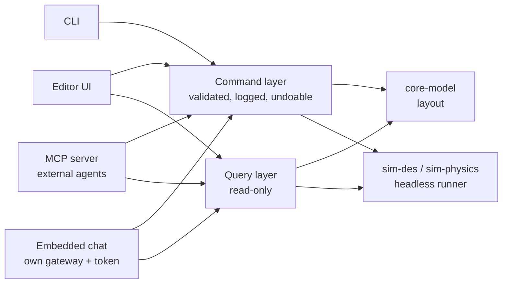

🌐 **EN** · [[A15 Integración con agentes de IA|ES]] · [[A15 KI-Agenten-Integration|DE]] · [[Home (EN)|Index]]

# A15 AI Agent Integration (design only — not implemented)

> **Rust platform (2026-10-31):** this note describes the TypeScript reference, which is frozen ([[ADR-0020 Rust Platform on BIMCraft with Three Modules]]). In the Rust platform agents use BIMCraft's existing CLI and MCP server (`bimcraft-cli mcp`), which run every command through `Session::execute`; IntraCraft's commands are registered there too.

**Requirement (project owner, 2026-10-29):** IntraCraft must be designed from the start so that AI agents can work with it, connecting either **directly** or through an **MCP server**. Like other tools the owner uses (e.g. SolidCraft), the app should offer a built-in way to enter **your own LLM gateway and API token** and chat with the application to control it. **Nothing is developed yet; this note fixes the architecture so that the code written from phase 2 onwards does not have to be reworked.** Decision: [[ADR-0004 AI-Ready Command Layer and MCP]].

## 1. The one rule that makes it possible: everything is a command

Every action that changes the project or the simulation goes through a single **command layer**, whoever triggers it: the editor UI, the CLI, an MCP client or the embedded chat.

| Property         | Rule                                                                                                        |
| ---------------- | ----------------------------------------------------------------------------------------------------------- |
| Typed            | Each command has a name and a Zod input schema; the same schema generates the JSON Schema of the agent tool |
| Validated        | Inputs validated before execution; library validation rules (3-roller rule, widths…) return warnings        |
| Atomic           | A command succeeds completely or changes nothing                                                            |
| Undoable         | Edit commands produce an inverse; one agent turn = one undo group                                           |
| Logged           | Command log with actor (`user`, `cli`, `mcp:<client>`, `chat`), time, input and result                      |
| Deterministic    | Replaying the command log on the same project + seed reproduces the same project and results                |
| No UI-only logic | If the UI can do it, a command can do it (the property panel calls `layout.setParams`)                      |

Queries (read-only) are separate from commands: agents can inspect freely, but changes always go through commands.

## 2. Draft command and query catalogue

| Name                                      | Kind            | Permission     | Purpose                                                        |
| ----------------------------------------- | --------------- | -------------- | -------------------------------------------------------------- |
| `project.new` / `.open` / `.save`         | command         | edit / file    | Project file lifecycle (`.intracraft.json`)                    |
| `library.list` / `.get`                   | query           | read           | Definitions, parameters (with units, ranges, choices), presets |
| `layout.get`                              | query           | read           | Instances, parameters, connections                             |
| `layout.addInstance`                      | command         | edit           | Place a definition with position, yaw and parameters           |
| `layout.setParams`                        | command         | edit           | Change parameters of one instance (e.g. sensor height)         |
| `layout.move`                             | command         | edit           | Position / yaw                                                 |
| `layout.connect` / `.disconnect`          | command         | edit           | Port connections (with alignment warnings)                     |
| `layout.remove`                           | command         | edit (confirm) | Delete instances                                               |
| `layout.validate`                         | query           | read           | All validation issues                                          |
| `sim.setMode`                             | command         | run            | 2D (DES) or 3D (physics); restarts the run                     |
| `sim.run` / `.step` / `.pause` / `.reset` | command         | run            | Run until a time or condition, with speed                      |
| `sim.snapshot`                            | query           | read           | Time, pallet poses, signals                                    |
| `results.statistics` / `.eventLog`        | query           | read           | Statistics per object, event trace (CSV/JSON)                  |
| `scenario.list` / `.run`                  | query / command | run            | Reference scenarios (T1–T6 …)                                  |

All values in SI units at this boundary (same as the project file); tools state the units in their descriptions so a model never guesses mm vs m.

## 3. Path A — MCP server (external agents)

Facts checked on 2026-10-29 against the official specification (revision **2026-07-28**):

- Messages are **JSON-RPC 2.0**; the 2026-07-28 revision is **stateless** (no protocol sessions; every request carries its own version and capability metadata).
- Standard transports: **stdio** (client launches the server as a subprocess) and **Streamable HTTP** (each message is an HTTP POST to one endpoint; replies as JSON or a request-scoped SSE stream). The old HTTP+SSE transport is deprecated.
- Server features: **tools** (functions the model executes), **resources** (context/data), **prompts** (templates). Client feature: **elicitation**. Optional extensions include **Tasks** (long-running operations with polling — a good fit for `sim.run` over hours of plant time) and **MCP Apps** (inline UI).
- Security principles of the spec: explicit user consent before data access and before invoking tools; tool descriptions from untrusted servers are untrusted.
- Official TypeScript SDK: `@modelcontextprotocol/sdk` (1.32.2, MIT).

**Planned mapping.**

| MCP primitive | IntraCraft                                                                                                                                                     |
| ------------- | -------------------------------------------------------------------------------------------------------------------------------------------------------------- |
| Tools         | Commands and queries of §2 (JSON Schema generated from the Zod schemas)                                                                                        |
| Resources     | `intracraft://project`, `intracraft://library/{id}`, `intracraft://results/{run}`, `intracraft://docs/{lang}/{note}` — agents can read the specs of this vault |
| Prompts       | Templates such as "build a line from source to sink", "find the bottleneck", "check this layout"                                                               |
| Tasks (ext.)  | Long simulation runs with progress and cancellation                                                                                                            |

**Deployment.** A new app `apps/mcp-server` (Node) using the same packages as the CLI: it opens a project file and runs the engines headless. **stdio first** (for desktop agent hosts); **Streamable HTTP later**, bound to `127.0.0.1` only, with a token, Origin validation and no remote exposure by default. Syncing a running editor with the server (file watch or local WebSocket) is a later step; the desktop version (Tauri) can host the server as a sidecar.

## 4. Path B — embedded chat with your own gateway and token

A chat panel inside the editor where the user talks to the application. The editor acts as the **agent host**: it sends the conversation and the tool definitions (§2) to a language model and executes the tool calls the model returns through the command layer.

**Settings (per user, never per project):**

| Setting     | Example / note                                                          |
| ----------- | ----------------------------------------------------------------------- |
| API style   | Adapter to use (first adapter planned: Anthropic Messages API)          |
| Gateway URL | Base URL of the provider or of the company's LLM gateway/proxy          |
| API token   | Key or bearer token for that gateway                                    |
| Model       | Free text with a default (for the Anthropic adapter: `claude-opus-5-5`) |
| Permission  | read-only · edit layout · edit + run simulations                        |

**Provider-agnostic design.** An `LlmAdapter` interface (send messages + tool definitions, receive text and tool calls) keeps the rest of the app independent of the provider. Each provider gets its own adapter built on its official SDK; the first one planned uses `@anthropic-ai/sdk` (1.3.0, Apache-2.0) with its `baseURL` option pointing at the configured gateway.

**Notes for the Anthropic adapter (checked 2026-10-29):**

- Tools are defined with `name`, `description` and `input_schema` (JSON Schema); set `strict: true` so arguments always validate against the schema.
- The model may request several tools in one turn; execute them and return **all** results in a single user message; failed tools return a result with `is_error: true` (never drop them).
- Always check `stop_reason` (`tool_use`, `end_turn`, `max_tokens`, `refusal`) before reading content.
- Forcing a specific tool (`tool_choice` `any`/`tool`) is rejected by the newest models: use `auto` and say in the system prompt which tools to use.
- Use streaming for long answers; validate every tool input before executing it, even with `strict`.
- The API's own remote-MCP connector needs a server reachable from the internet, so it does **not** fit a local app; the embedded chat calls the commands locally instead.

**Token safety.** Stored in the OS keychain in the desktop version; in the local web version kept in memory for the session by default (optional browser storage with a clear warning). Never written to the project file, logs, event traces or exported results; redacted in error messages.

## 5. Safety and control (both paths)

1. **Consent and confirmation** — destructive or long actions (`layout.remove`, overwrite on `project.save`, long `sim.run`) ask the user, as the MCP spec requires for tool invocation.
2. **Permission levels** — read-only by default for new agents; the user raises it.
3. **Limits** — maximum tool calls per turn and maximum simulated time per request.
4. **Visibility** — the chat shows every tool call and its result; the command log marks agent actions.
5. **Undo** — one click undoes a whole agent turn.
6. **Untrusted data** — instance names, descriptions and imported files are data, never instructions to the agent (prompt-injection defence).

## 6. Phasing

| Phase (see [[A12 Roadmap]])  | AI-related deliverable                                                             |
| ---------------------------- | ---------------------------------------------------------------------------------- |
| 2 — core and library         | Command and query layer with Zod schemas, command log, undo; UI uses only commands |
| 3 — roller conveyor 2D       | Headless runner shared by CLI and future MCP server                                |
| After 3 (MVP or right after) | `apps/mcp-server` over stdio; tools/resources/prompts of §2–3                      |
| Post-MVP                     | Embedded chat with own gateway + token; Streamable HTTP; MCP Tasks                 |

## Related

[[ADR-0004 AI-Ready Command Layer and MCP]] · [[A02 Architecture]] · [[A10 CLI and Scenarios]] · [[A13 Conventions]]
