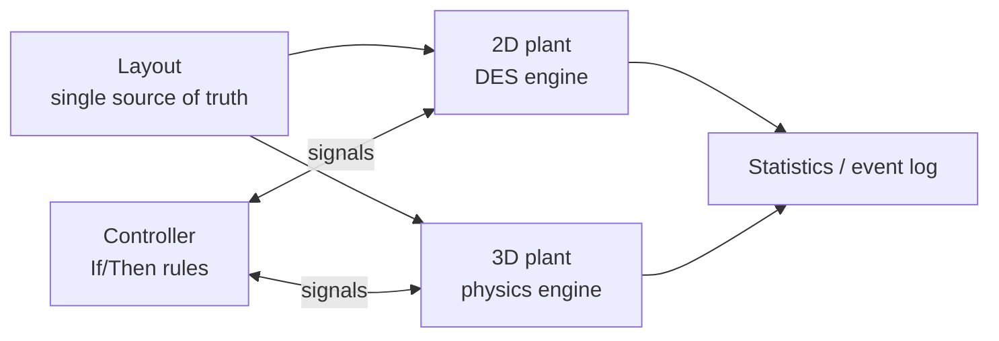

🌐 **EN** · [[T01 Paradigmas de simulación|ES]] · [[T01 Simulationsparadigmen|DE]] · [[Home (EN)|Index]]

# T01 Simulation Paradigms

## 1. What a simulation model is

A simulation model is a description of a system's **state** and of the **rules** that change that state over **time**. For a pallet conveyor the state is, for example: where each pallet is, how fast it moves, which sensors are blocked, which stops are up, and what each conveyor motor is doing.

Models are usually classified along four axes:

| Axis            | Option A                   | Option B                      | IntraCraft                                    |
| --------------- | -------------------------- | ----------------------------- | --------------------------------------------- |
| Time dependence | Static (no time)           | Dynamic (state evolves)       | Dynamic                                       |
| Randomness      | Deterministic              | Stochastic (random inputs)    | Both: random inputs from a **seeded** RNG     |
| Time base       | Continuous time            | Discrete time (steps)         | 2D: continuous time, event-driven · 3D: steps |
| State changes   | Continuous (e.g. position) | Discrete (e.g. sensor on/off) | Mixed                                         |

## 2. The three families that matter here

### 2.1 Discrete-event simulation (DES)

The state is assumed to change only at a countable set of instants called **events** (a pallet enters, a front reaches a sensor, a turntable finishes turning). Between two events nothing "interesting" happens, so the simulator **jumps** the clock straight to the next event. This is why the 2D mode can run 1000× faster than real time: a 12 s pallet journey may need only 3–4 events.

Key idea for conveyors: positions *do* change continuously between events, but they follow known formulas (constant acceleration or constant speed). The engine stores those formulas as **kinematic segments** and evaluates them only when needed — to predict the next event or to animate the viewer. See [[T02 Discrete-Event Simulation]] and [[T04 Conveyor Kinematics]].

### 2.2 Time-stepped (continuous) simulation

The model is a set of differential equations $\dot{x} = f(x, t)$ integrated with a step $\Delta t$. Every quantity is recomputed every step whether something happens or not. Cost grows with simulated time / $\Delta t$, not with the number of events.

### 2.3 Rigid-body physics simulation

A special time-stepped simulation where the equations are Newton–Euler equations of rigid bodies plus **constraints** (contacts, friction, joints) solved every step. It reproduces effects that no formula in the 2D mode contains: slipping on rollers, rebound at a stop, a pallet turning when it hits a single stop off-centre, a funnel straightening a misaligned pallet, a chain falling into a void of the pallet. See [[T09 Rigid Body Dynamics]] to [[T14 Stops, Impacts and Alignment]].

## 3. Why one product uses two paradigms

| Question you ask                                  | Best answered by | Why                                              |
| ------------------------------------------------- | ---------------- | ------------------------------------------------ |
| How many pallets per hour can this loop handle?   | 2D (DES)         | Needs hours of simulated time, many replications |
| Where do pallets queue and for how long?          | 2D (DES)         | Statistics over long runs                        |
| Does the pallet stop within ±5 mm of the stop?    | 3D (physics)     | Depends on friction, mass, restitution           |
| Will a 50 mm / 5° misaligned pallet be corrected? | 3D (physics)     | Depends on contact geometry                      |
| Does the photoeye flicker through pallet voids?   | Both             | 2D uses the occupancy profile, 3D real geometry  |
| Is the control logic correct?                     | Both             | Same controller drives both plants               |

**Speed vs fidelity.** The 2D mode targets ≥ 1000× real time with 50 objects and 30 pallets; the 3D mode targets real time (60 FPS) with 20 conveyors and 10 pallets, advancing physics at a fixed 1/120 s.

Worked example — T1 (3 m, 0.25 m/s, 0.5 m/s²): the 2D mode computes the arrival at 12.25 s with one closed-form formula and **one** scheduled event. The 3D mode needs $12.25 \times 120 = 1470$ physics steps, each solving every roller–board contact.

## 4. The hybrid architecture

1. **The layout is the source of truth.** Both plants are *derived* from it.
2. **Same control logic, different plant.** The controller only sees boolean signals (sensors in, actuators out). It cannot tell whether it talks to an abstract model or to physics — the same idea as *virtual commissioning*. See [[T07 Control Logic and Signals]].
3. **Switching mode restarts the simulation** in the MVP; mid-run state transfer is post-MVP.
4. **Consistency is measured**, not assumed: transit times within ±5 % and sensor edges within ±50 ms between modes. Differences feed calibration. See [[T16 Hybrid Consistency and Calibration]].

## 5. Common pitfalls

- Treating the 2D mode as "inaccurate physics". It is *exact* for its assumptions (no slip, ideal stops); its limits are the assumptions, not numerical error.
- Treating the 3D mode as "the truth". It is only as good as the friction, mass and restitution values, which are indicative until calibrated.
- Mixing paradigms inside one engine. IntraCraft keeps them in separate packages (`sim-des`, `sim-physics`) behind the same controller.

## Related

[[T02 Discrete-Event Simulation]] · [[T10 Time Integration and Fixed Step]] · [[A02 Architecture]]
