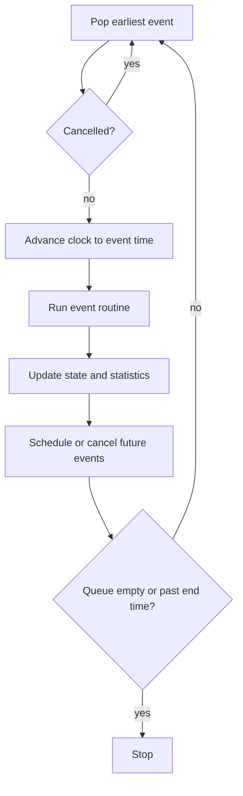

🌐 **EN** · [[T02 Simulación de eventos discretos|ES]] · [[T02 Ereignisdiskrete Simulation|DE]] · [[Home (EN)|Index]]

# T02 Discrete-Event Simulation

## 1. Vocabulary

| Term              | Definition                                      | In IntraCraft                                                           |
| ----------------- | ----------------------------------------------- | ----------------------------------------------------------------------- |
| Entity            | Object that flows through the system            | Pallet                                                                  |
| Resource / server | Object that entities occupy or wait for         | Conveyor zone, turntable, transfer table                                |
| Attribute         | Property of an entity                           | Pallet type, mass, load height, custom key–values                       |
| State variable    | Value describing the system at time *t*         | Zone occupied, stop up, motor running                                   |
| Event             | Instant at which the state changes              | `front_reaches_stop`, `sensor_edge`, `turn_completed`                   |
| Activity          | Interval between two events with known duration | Turning 90° (6.5 s), lifting chains (1 s)                               |
| Simulation clock  | Current simulated time                          | Integer microseconds (see [[T03 Time, Event Ordering and Determinism]]) |
| Future event list | Ordered set of scheduled events                 | Binary min-heap `EventQueue`                                            |

## 2. Next-event time advance

The core of any DES engine is a loop that repeatedly takes the **earliest** scheduled event, moves the clock to its time and executes its **event routine**. The routine updates the state and may schedule new events or cancel existing ones.

```text
clock ← 0
schedule initial events (sources, controller start)
while FEL not empty and next.time ≤ endTime:
    e ← FEL.popMin()                 # by (time, priority, sequence)
    if e was cancelled: continue     # stale prediction
    clock ← e.time
    handler[e.type](e)               # update state, schedule/cancel events
    log e                            # event trace → statistics, hashing
```



The clock never advances in small steps: if the next event is at 12.25 s, the clock goes from 0 to 12.25 s in one assignment. Simulated time is therefore decoupled from computing time.

## 3. World views

Three classic ways of writing DES models:

1. **Event scheduling** — the modeller writes one routine per event type (what we do).
2. **Activity scanning** — the modeller writes conditions; the engine scans all of them after every event.
3. **Process interaction** — each entity is a process that "waits" (coroutines); common in commercial tools.

IntraCraft uses **event scheduling organised per component**: each library behaviour (e.g. `des.roller_conveyor`) handles the events that target it. The If/Then controller is a light form of activity scanning, re-evaluated only when a signal changes ([[T07 Control Logic and Signals]]).

## 4. Conveyors as tracks: prediction instead of stepping

A conveyor is modelled as a **track** (1D coordinate $s$ along the direction of travel) holding an ordered list of pallets. Each pallet is an interval $[s_{tail}, s_{front}]$ and has a current **kinematic segment** $(t_0, s_0, v_0, a)$:

$$s(t) = s_0 + v_0 (t - t_0) + \tfrac{1}{2} a (t - t_0)^2$$

After each event the engine **predicts** the next interesting crossing for each affected pallet by solving that quadratic for $s(t) = s^\*$ — a sensor position, a stop, the end of a zone, the tail of the pallet in front minus the minimum gap ([[T04 Conveyor Kinematics]], function `timeToReach`). Only the earliest crossing is scheduled.

### Stale predictions

Predictions become wrong when something changes before they happen — a stop rises, a motor stops, the pallet in front brakes. Two equivalent techniques exist:

- **Cancellation tickets** (implemented in `DesSimulator.cancel`): keep the ticket of each prediction and cancel it; the queue skips it lazily when popped.
- **Version numbers** (planned per pallet): each pallet carries a version that increments when its motion changes; an event whose stored version differs from the current one is ignored.

Both avoid the cost of removing an arbitrary element from a heap.

## 5. Example: one pallet on a 3 m roller conveyor with a sensor

| t (s)  | Event                   | What the routine does                                                           |
| ------ | ----------------------- | ------------------------------------------------------------------------------- |
| 0.000  | `pallet_enters`         | Segment $(0, 0, 0, 0.5)$; predict end of ramp and sensor crossing               |
| 0.500  | `ramp_ends`             | New segment at $v = 0.25$ m/s, $a = 0$                                          |
| 8.250  | `sensor_edge` (rising)  | Front at 2.0 m: $t = 0.5 + (2.0 - 0.0625)/0.25$; signal → controller            |
| 12.250 | `front_reaches_end`     | Hand over to the next conveyor through port B (T1)                              |
| 13.050 | `sensor_edge` (falling) | Tail passes 2.0 m (front at 3.2 m): pallet length / v = 4.8 s after rising (T6) |

Five events instead of thousands of steps. The viewer animates the pallet between events by evaluating $s(t)$ at each frame — "analytic interpolation".

## 6. Simultaneous events

Two events can share the same time (two pallets released by the same rule). The order then matters — does the sensor edge get processed before the controller reacts? IntraCraft breaks ties with an explicit **priority** and then the **insertion sequence**, which makes the result reproducible. See [[T03 Time, Event Ordering and Determinism]].

## 7. Event types planned for the MVP

`pallet_enters`, `front_reaches_stop`, `tail_clears_entry`, `sensor_edge`, `zone_released`, `turn_completed`, `lift_completed`, `transfer_completed`, `signal_changed`, `rule_fired`.

## 8. Cost

Each event costs $O(\log n)$ for the heap plus the work of the routine. Throughput studies of hours of plant time need only seconds of computation — the target is ≥ 1000× real time with 50 objects and 30 pallets.

## Related

[[T03 Time, Event Ordering and Determinism]] · [[T04 Conveyor Kinematics]] · [[T05 Accumulation, Capacity and Throughput]] · [[A06 DES Engine]]
