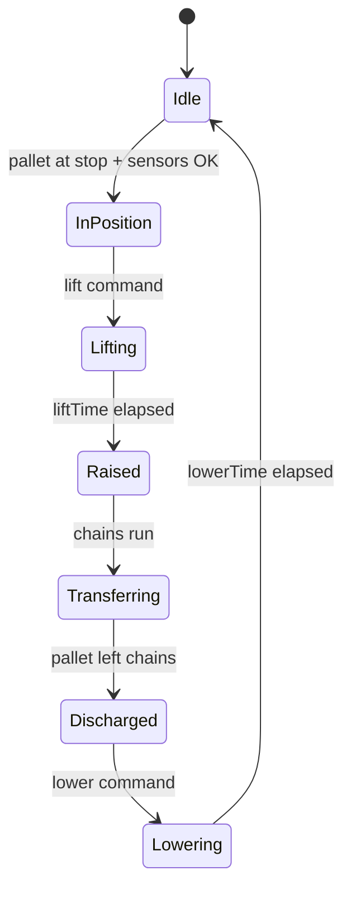

🌐 **EN** · [[T07 Lógica de control y señales|ES]] · [[T07 Steuerungslogik und Signale|DE]] · [[Home (EN)|Index]]

# T07 Control Logic and Signals

## 1. Plant and controller

A conveyor installation has a **plant** (mechanics: conveyors, stops, sensors) and a **controller** (in reality a PLC). They only communicate through **signals**:

- **Inputs to the controller** = sensor outputs: `pe1`, `zone2.occupied`, `turntable.atStation`…
- **Outputs from the controller** = actuator commands: `zone1.run`, `stop1.up`, `turntable.goToStation`, `transfer.liftChains`…

IntraCraft keeps this separation strictly: the same controller drives the 2D plant and the 3D plant. This is what makes 2D/3D comparisons meaningful and is the basis of *virtual commissioning*.

## 2. Boolean signals and edges

MVP signals are booleans. Logic often depends not on the value but on its **change**:

| Edge    | Definition                   | Typical use                                      |
| ------- | ---------------------------- | ------------------------------------------------ |
| Rising  | previous = false, now = true | "Pallet arrived at the sensor"                   |
| Falling | previous = true, now = false | "Pallet tail has left the sensor" → release next |

An edge exists only at one evaluation; a level (`is: true`) holds as long as the value holds.

## 3. If/Then rules

A rule is `WHEN all conditions THEN write signals (optionally after a delay)`:

```json
{
  "id": "stop-up-after-pass",
  "when": [{ "signal": "pe1", "edge": "falling" }],
  "then": [{ "signal": "stop1.up", "value": true, "delayMs": 200 }]
}
```

The evaluator (`packages/control/src/rules.ts`) is a **pure function**: `evaluateRules(rules, previous, current) → writes`. It never reads a clock and never touches the plant; the caller applies the writes and schedules delays. That purity is what lets both modes share it.

### Delays and timers

`delayMs` is the MVP's timer: the write takes effect later. In 2D the delay becomes a scheduled `signal_changed` event at `now + delay`; in 3D it becomes a pending write applied at the first control cycle ≥ that time. (Cancellation of a pending delayed write when the condition disappears — "on-delay timer" semantics — is to be specified.)

## 4. When are rules evaluated?

| Mode | Evaluation                                      | Consequence                                                       |
| ---- | ----------------------------------------------- | ----------------------------------------------------------------- |
| 2D   | Whenever any signal changes (event-driven)      | Exact edge times; no sampling delay                               |
| 3D   | Every control cycle (default 10 ms), like a PLC | Up to 10 ms extra delay; edges shorter than a cycle can be missed |

A PLC executes a **scan cycle**: read all inputs → execute logic → write all outputs. The 3D mode reproduces this. In 2D, evaluating on each change is equivalent to an infinitely fast PLC; if a scenario depends on the scan time, the 2D mode can be configured to evaluate on a 10 ms grid too.

**Pitfall — pulses shorter than the scan.** A falling edge followed by a rising edge within 10 ms is invisible to a 3D controller but visible in 2D. Use filters on sensors ([[T06 Photoelectric Sensing]]) rather than relying on very short pulses.

## 5. Interlocks

An **interlock** is a condition that must hold before an action is allowed, independent of what the rules request. They protect equipment and pallets:

- Turntable: do not turn unless the pallet is centred (`requiresCenteredPallet`) and no pallet straddles the edge.
- Transfer table: do not lift without a pallet in position; rollers stopped while chains are up; do not lower before the pallet has left the chains; in bidirectional mode never accept from both sides.

Interlocks live **inside the component behaviour**, not in user rules, so a wrong rule cannot break the equipment model. A blocked command is logged as a warning.

## 6. State machines

Complex components are sequenced as finite state machines. Transfer table:



In 2D each transition with a known duration is a scheduled event (`lift_completed` after `liftTime`); in 3D the same transitions are triggered when the kinematic chains reach their target positions.

## 7. Control templates included in the MVP

| Template                           | Logic in words                                                                       |
| ---------------------------------- | ------------------------------------------------------------------------------------ |
| Zero-pressure accumulation (ZPA)   | Zone *i* runs while zone *i+1* is free; holds when both are occupied                 |
| Stop with sensor                   | Stop up by default; lower when downstream is free; raise again after the tail passes |
| Turntable waits for centred pallet | Receive → when centred: stop chains → turn → settle → discharge                      |
| Transfer with full sequence        | State machine of §6 with all interlocks                                              |

The ZPA template is tested in `control/src/rules.test.ts`.

## Related

[[T05 Accumulation, Capacity and Throughput]] · [[T13 Turntables and Transfer Lifts]] · [[A08 Controller]]
