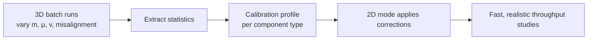

🌐 **EN** · [[T16 Consistencia híbrida y calibración|ES]] · [[T16 Hybride Konsistenz und Kalibrierung|DE]] · [[Home (EN)|Index]]

# T16 Hybrid Consistency and Calibration

## 1. Why the two modes differ at all

The 2D mode is exact for an **ideal** plant; the 3D mode simulates a **non-ideal** one. Differences come from effects the 2D model does not contain:

| Effect                      | 2D assumption                     | 3D reality                                       |
| --------------------------- | --------------------------------- | ------------------------------------------------ |
| Traction                    | Pallet speed = surface speed      | Micro-slip, slip at low μ or steep ramps         |
| Stop impact                 | Instant stop at the stop position | Rebound, settling, rotation                      |
| Hand-over between conveyors | Rule (e.g. min speed)             | Contacts on both conveyors, the gap between them |
| Turntable                   | Pallet fixed to platform          | Small sliding under acceleration                 |
| Sensors                     | Analytic edges                    | Step-quantised raycasts, real geometry           |
| Control                     | Event-driven (instant)            | Sampled every 10 ms                              |

## 2. Consistency criteria (MVP)

For every reference scenario, run both modes and compare:

| Quantity          | Tolerance |
| ----------------- | --------- |
| Transit times     | ±5 %      |
| Sensor edge times | ±50 ms    |

A larger difference is a **finding**, not something to hide: either a bug, a missing rule in 2D, or a missing calibration parameter. Never tune friction, masses or time steps to make the numbers agree without a decision note (AGENTS.md).

## 3. Calibration (post-MVP, the main differentiator)

Run **batches of 3D experiments** varying mass, friction, entry speed and misalignment, and extract statistics:

- transit-time correction per conveyor type (e.g. +0.12 s per start/stop at μ = 0.3);
- probability of jam / misalignment beyond tolerance;
- final position error distribution at stops.

These become **calibration profiles** that the 2D mode applies (as extra delays, distributions or failure probabilities). The 2D mode thus gains realism while keeping its 1000× speed.

## 4. Mid-run mode switch (post-MVP)

Switching mode while running requires converting state between worlds. It is only well defined when pallets are in **stable poses** (at rest or moving with a known speed, not mid-impact). In the MVP the switch restarts the simulation.

## Related

[[T01 Simulation Paradigms]] · [[T06 Photoelectric Sensing]] · [[A11 Testing and Validation]]
