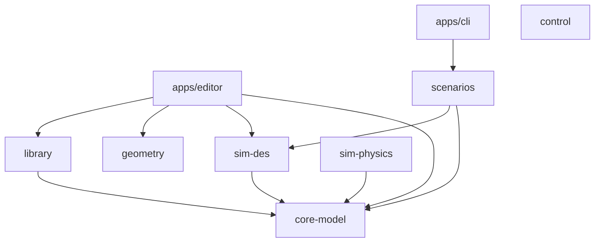
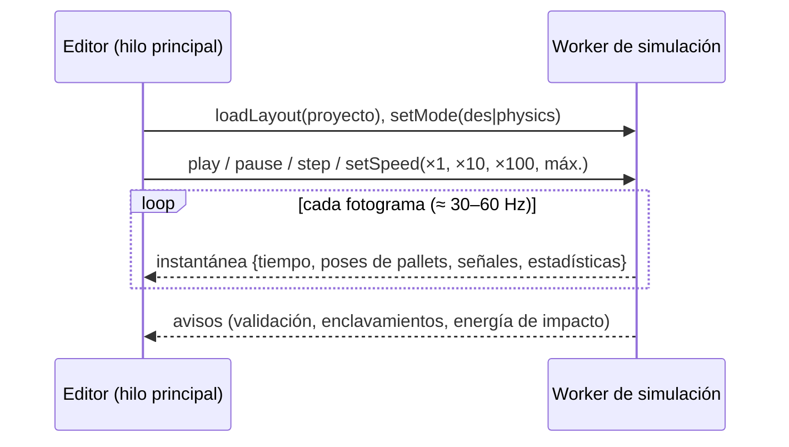

🌐 [[A02 Architecture|EN]] · **ES** · [[A02 Architektur|DE]] · [[Inicio (ES)|Índice]]

# A02 Arquitectura

## 1. Capas

| Capa           | Paquete       | Responsabilidad                                                                         | Depende de                                  |
| -------------- | ------------- | --------------------------------------------------------------------------------------- | ------------------------------------------- |
| Modelo         | `core-model`  | Unidades, tiempo, generador con semilla, logger, esquema de proyecto/layout, validación | zod                                         |
| Librería       | `library`     | Definiciones de componentes (JSON), datos de referencia, reglas de validación, registro | core-model, zod                             |
| Geometría      | `geometry`    | Disposición paramétrica de rodillos, cadenas y bastidores (números puros)               | —                                           |
| Motor discreto | `sim-des`     | Cola de eventos, bucle del simulador, cinemática analítica, estadísticas                | core-model                                  |
| Motor físico   | `sim-physics` | Interfaz de backend, reloj de paso fijo, mecánica en forma cerrada                      | core-model (+ Jolt/Rapier tras S1)          |
| Controlador    | `control`     | Señales booleanas y reglas Si/Entonces                                                  | —                                           |
| Escenarios     | `scenarios`   | Escenarios de referencia y resultados esperados                                         | core-model, sim-des                         |
| Editor         | `apps/editor` | Interfaz, visor 2D/3D, paneles de propiedades y de librería                             | React, react-three-fiber, Zustand, paquetes |
| CLI            | `apps/cli`    | Ejecuta escenarios sin interfaz                                                         | scenarios                                   |

**Regla firme:** `sim-des`, `sim-physics` y `control` nunca importan React, three.js ni el DOM, y nunca llaman a `Math.random()`. ESLint impone ambas cosas.

## 2. Grafo de dependencias



## 3. Ejecución: hilo de interfaz y worker de simulación



- La simulación (2D o 3D) corre en un **Web Worker** para que la interfaz nunca se congele.
- La interfaz solo recibe **instantáneas**; nunca modifica el estado de la simulación directamente.
- 3D: paso fijo de física (1/120 s) con acumulador; el visor interpola ([[T10 Integración temporal y paso fijo]]).
- 2D: el reloj salta entre eventos; el visor evalúa el segmento cinemático de cada pallet en el instante del fotograma ([[T02 Simulación de eventos discretos]]).
- Las instantáneas deberían usar arrays tipados transferibles (posiciones, cuaterniones) para evitar copias; se implementará en las fases 3/4.

## 4. Del layout a la planta en marcha

1. Se lee y valida el archivo de proyecto (`projectSchema`, [[A04 Modelo de datos y archivo de proyecto]]).
2. La definición de cada instancia se obtiene del registro ([[A05 Librería de componentes]]).
3. El modo construye su planta: el modo DES instancia `behaviors.des` de la definición y el modo físico `behaviors.physics`.
4. Las conexiones enlazan puertos de salida con puertos de entrada; el controlador se enlaza con las señales.
5. Ejecutar.

## 5. Contrato de comportamiento (previsto)

```ts
interface ComponentBehavior<P> {
  readonly id: string;
  init(ctx: SimContext, params: P): void;
  onEvent?(ctx: DesContext, event: SimEvent): void;   // modo 2D
  step?(ctx: PhysicsContext, dt: number): void;       // modo 3D
  readSignals(): Record<string, boolean>;             // salidas hacia el controlador
  writeSignals(inputs: Record<string, boolean>): void;
  statistics(): Record<string, number>;
}
```

Los datos (JSON) describen **qué es** un componente; los comportamientos TypeScript registrados implementan **cómo se comporta**. La interfaz y las validaciones salen de los datos; la lógica vive en módulos con pruebas.

## 6. Agentes de IA

Todo cambio de estado pasa por una capa de comandos que comparten la interfaz, la CLI, un servidor MCP y un chat integrado; las lecturas van por una capa de consultas. Por ahora solo diseño: [[A15 Integración con agentes de IA]] y [[ADR-0004 Capa de comandos y MCP para agentes de IA]].

## Relacionado

[[A03 Monorepo y stack]] · [[A06 Motor discreto]] · [[A07 Envoltorio del motor físico]] · [[A08 Controlador]] · [[A09 Editor y visor]]
