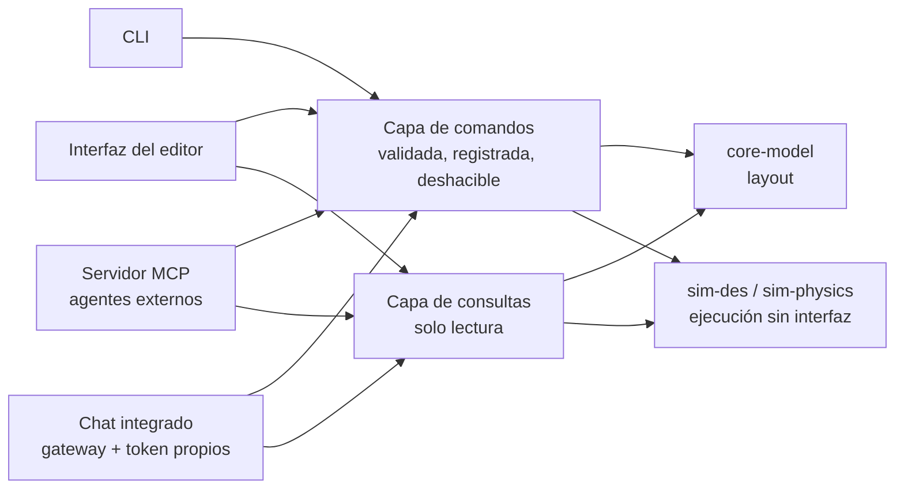

🌐 [[A15 AI Agent Integration|EN]] · **ES** · [[A15 KI-Agenten-Integration|DE]] · [[Inicio (ES)|Índice]]

# A15 Integración con agentes de IA (solo diseño, sin implementar)

**Requisito (responsable del proyecto, 29-10-2026):** IntraCraft debe estar pensada desde el principio para que trabajen con ella agentes de IA, conectados **directamente** o a través de un **servidor MCP**. Como en otras herramientas que usa el responsable (p. ej. SolidCraft), la aplicación debe ofrecer una forma integrada de introducir **tu propio gateway de LLM y tu token de API** y chatear con la aplicación para controlarla. **Todavía no se desarrolla nada; esta nota fija la arquitectura para que el código que se escriba desde la fase 2 no haya que rehacerlo.** Decisión: [[ADR-0004 Capa de comandos y MCP para agentes de IA]].

## 1. La regla que lo hace posible: todo es un comando

Toda acción que cambia el proyecto o la simulación pasa por una única **capa de comandos**, la lance quien la lance: la interfaz del editor, la CLI, un cliente MCP o el chat integrado.

| Propiedad             | Regla                                                                                                                   |
| --------------------- | ----------------------------------------------------------------------------------------------------------------------- |
| Tipado                | Cada comando tiene nombre y esquema de entrada Zod; el mismo esquema genera el JSON Schema de la herramienta del agente |
| Validado              | Entradas validadas antes de ejecutar; las reglas de la librería (3 rodillos, anchos…) devuelven avisos                  |
| Atómico               | Un comando se completa entero o no cambia nada                                                                          |
| Deshacible            | Los comandos de edición generan su inverso; un turno del agente = un grupo de deshacer                                  |
| Registrado            | Registro de comandos con actor (`user`, `cli`, `mcp:<cliente>`, `chat`), hora, entrada y resultado                      |
| Determinista          | Reproducir el registro sobre el mismo proyecto y semilla da el mismo proyecto y resultados                              |
| Sin lógica solo de UI | Si la interfaz puede hacerlo, un comando puede hacerlo (el panel de propiedades llama a `layout.setParams`)             |

Las consultas (solo lectura) van separadas de los comandos: los agentes pueden inspeccionar libremente, pero los cambios siempre pasan por comandos.

## 2. Borrador del catálogo de comandos y consultas

| Nombre                                    | Tipo               | Permiso             | Para qué                                                          |
| ----------------------------------------- | ------------------ | ------------------- | ----------------------------------------------------------------- |
| `project.new` / `.open` / `.save`         | comando            | edición / archivo   | Ciclo de vida del archivo (`.intracraft.json`)                    |
| `library.list` / `.get`                   | consulta           | lectura             | Definiciones, parámetros (unidades, rangos, opciones), presets    |
| `layout.get`                              | consulta           | lectura             | Instancias, parámetros, conexiones                                |
| `layout.addInstance`                      | comando            | edición             | Colocar una definición con posición, giro y parámetros            |
| `layout.setParams`                        | comando            | edición             | Cambiar parámetros de una instancia (p. ej. altura de fotocélula) |
| `layout.move`                             | comando            | edición             | Posición / giro                                                   |
| `layout.connect` / `.disconnect`          | comando            | edición             | Conexiones entre puertos (con avisos de alineación)               |
| `layout.remove`                           | comando            | edición (confirmar) | Borrar instancias                                                 |
| `layout.validate`                         | consulta           | lectura             | Todos los avisos de validación                                    |
| `sim.setMode`                             | comando            | ejecución           | 2D (DES) o 3D (física); reinicia la ejecución                     |
| `sim.run` / `.step` / `.pause` / `.reset` | comando            | ejecución           | Ejecutar hasta un tiempo o condición, con velocidad               |
| `sim.snapshot`                            | consulta           | lectura             | Tiempo, poses de pallets, señales                                 |
| `results.statistics` / `.eventLog`        | consulta           | lectura             | Estadísticas por objeto, traza de eventos (CSV/JSON)              |
| `scenario.list` / `.run`                  | consulta / comando | ejecución           | Escenarios de referencia (T1–T6 …)                                |

Todos los valores en unidades SI en esta frontera (igual que en el archivo de proyecto); las herramientas indican las unidades en su descripción para que el modelo nunca confunda mm con m.

## 3. Vía A — servidor MCP (agentes externos)

Datos comprobados el 29-10-2026 contra la especificación oficial (revisión **2026-07-28**):

- Los mensajes son **JSON-RPC 2.0**; la revisión 2026-07-28 es **sin estado** (sin sesiones de protocolo; cada petición lleva su versión y capacidades).
- Transportes estándar: **stdio** (el cliente lanza el servidor como subproceso) y **Streamable HTTP** (cada mensaje es un POST a un único endpoint; respuestas en JSON o en un flujo SSE por petición). El antiguo transporte HTTP+SSE está en desuso.
- Funciones del servidor: **tools** (funciones que ejecuta el modelo), **resources** (contexto/datos), **prompts** (plantillas). Función del cliente: **elicitation**. Extensiones opcionales: **Tasks** (operaciones largas con sondeo; encaja con `sim.run` de horas de planta) y **MCP Apps** (interfaz embebida).
- Principios de seguridad de la especificación: consentimiento explícito del usuario antes de acceder a datos e invocar herramientas; las descripciones de herramientas de servidores no fiables no son fiables.
- SDK oficial de TypeScript: `@modelcontextprotocol/sdk` (1.32.2, MIT).

**Correspondencia prevista.**

| Primitiva MCP | IntraCraft                                                                                                                                                                        |
| ------------- | --------------------------------------------------------------------------------------------------------------------------------------------------------------------------------- |
| Tools         | Comandos y consultas del §2 (JSON Schema generado desde los esquemas Zod)                                                                                                         |
| Resources     | `intracraft://project`, `intracraft://library/{id}`, `intracraft://results/{run}`, `intracraft://docs/{lang}/{note}`: los agentes pueden leer las especificaciones de esta bóveda |
| Prompts       | Plantillas como «construye una línea de generador a sumidero», «busca el cuello de botella», «revisa este layout»                                                                 |
| Tasks (ext.)  | Ejecuciones largas con progreso y cancelación                                                                                                                                     |

**Despliegue.** Una aplicación nueva `apps/mcp-server` (Node) que usa los mismos paquetes que la CLI: abre un archivo de proyecto y ejecuta los motores sin interfaz. **Primero stdio** (para hosts de agentes de escritorio); **Streamable HTTP después**, solo en `127.0.0.1`, con token, validación de Origin y sin exposición remota por defecto. Sincronizar un editor abierto con el servidor (vigilancia de archivo o WebSocket local) es un paso posterior; la versión de escritorio (Tauri) puede alojar el servidor como proceso auxiliar.

## 4. Vía B — chat integrado con tu propio gateway y token

Un panel de chat dentro del editor donde el usuario habla con la aplicación. El editor actúa como **host del agente**: envía la conversación y las definiciones de herramientas (§2) a un modelo de lenguaje y ejecuta, a través de la capa de comandos, las llamadas a herramientas que devuelve el modelo.

**Ajustes (por usuario, nunca por proyecto):**

| Ajuste          | Ejemplo / nota                                                             |
| --------------- | -------------------------------------------------------------------------- |
| Estilo de API   | Adaptador a usar (primer adaptador previsto: Anthropic Messages API)       |
| URL del gateway | URL base del proveedor o del gateway/proxy de LLM de la empresa            |
| Token de API    | Clave o token portador para ese gateway                                    |
| Modelo          | Texto libre con valor por defecto (adaptador Anthropic: `claude-opus-5-5`) |
| Permiso         | solo lectura · editar layout · editar + ejecutar simulaciones              |

**Diseño independiente del proveedor.** Una interfaz `LlmAdapter` (enviar mensajes + definiciones de herramientas, recibir texto y llamadas a herramientas) mantiene el resto de la aplicación independiente del proveedor. Cada proveedor tiene su propio adaptador sobre su SDK oficial; el primero previsto usa `@anthropic-ai/sdk` (1.3.0, Apache-2.0) con la opción `baseURL` apuntando al gateway configurado.

**Notas para el adaptador de Anthropic (comprobadas el 29-10-2026):**

- Las herramientas se definen con `name`, `description` e `input_schema` (JSON Schema); poner `strict: true` para que los argumentos siempre cumplan el esquema.
- El modelo puede pedir varias herramientas en un turno: se ejecutan y se devuelven **todos** los resultados en un único mensaje de usuario; las que fallan devuelven un resultado con `is_error: true` (nunca se omiten).
- Comprobar siempre `stop_reason` (`tool_use`, `end_turn`, `max_tokens`, `refusal`) antes de leer el contenido.
- Forzar una herramienta concreta (`tool_choice` `any`/`tool`) lo rechazan los modelos más nuevos: usar `auto` e indicar en el prompt de sistema qué herramientas usar.
- Usar streaming para respuestas largas; validar cada entrada de herramienta antes de ejecutarla, incluso con `strict`.
- El conector MCP remoto de la propia API necesita un servidor accesible desde internet, así que **no** sirve para una aplicación local; el chat integrado llama a los comandos localmente.

**Seguridad del token.** Se guarda en el llavero del sistema operativo en la versión de escritorio; en la versión web local se mantiene en memoria durante la sesión por defecto (almacenamiento del navegador opcional con un aviso claro). Nunca se escribe en el archivo de proyecto, los logs, las trazas de eventos ni los resultados exportados; se oculta en los mensajes de error.

## 5. Seguridad y control (ambas vías)

1. **Consentimiento y confirmación** — las acciones destructivas o largas (`layout.remove`, sobrescribir con `project.save`, `sim.run` largo) preguntan al usuario, como exige la especificación MCP para invocar herramientas.
2. **Niveles de permiso** — solo lectura por defecto para agentes nuevos; el usuario lo amplía.
3. **Límites** — número máximo de llamadas por turno y tiempo simulado máximo por petición.
4. **Visibilidad** — el chat muestra cada llamada y su resultado; el registro de comandos marca las acciones del agente.
5. **Deshacer** — un clic deshace un turno completo del agente.
6. **Datos no fiables** — nombres de instancias, descripciones y archivos importados son datos, nunca instrucciones para el agente (defensa frente a inyección de prompts).

## 6. Fases

| Fase (ver [[A12 Hoja de ruta]]) | Entregable relacionado con IA                                                                                |
| ------------------------------- | ------------------------------------------------------------------------------------------------------------ |
| 2 — núcleo y librería           | Capa de comandos y consultas con esquemas Zod, registro de comandos, deshacer; la interfaz solo usa comandos |
| 3 — mesa de rodillos 2D         | Ejecución sin interfaz compartida por la CLI y el futuro servidor MCP                                        |
| Tras la 3 (MVP o justo después) | `apps/mcp-server` por stdio; tools/resources/prompts del §2–3                                                |
| Post-MVP                        | Chat integrado con gateway y token propios; Streamable HTTP; Tasks de MCP                                    |

## Relacionado

[[ADR-0004 Capa de comandos y MCP para agentes de IA]] · [[A02 Arquitectura]] · [[A10 CLI y escenarios]] · [[A13 Convenciones]]
