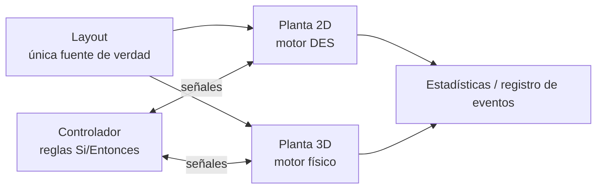

🌐 [[T01 Simulation Paradigms|EN]] · **ES** · [[T01 Simulationsparadigmen|DE]] · [[Inicio (ES)|Índice]]

# T01 Paradigmas de simulación

## 1. Qué es un modelo de simulación

Un modelo de simulación describe el **estado** de un sistema y las **reglas** que cambian ese estado a lo largo del **tiempo**. En un transporte de pallets el estado es, por ejemplo: dónde está cada pallet, a qué velocidad se mueve, qué sensores están ocupados, qué topes están arriba y qué hace cada motor.

Los modelos suelen clasificarse según cuatro ejes:

| Eje                    | Opción A                    | Opción B                          | IntraCraft                                               |
| ---------------------- | --------------------------- | --------------------------------- | -------------------------------------------------------- |
| Dependencia del tiempo | Estático (sin tiempo)       | Dinámico (el estado evoluciona)   | Dinámico                                                 |
| Aleatoriedad           | Determinista                | Estocástico (entradas aleatorias) | Ambos: entradas aleatorias con generador **con semilla** |
| Base de tiempo         | Tiempo continuo             | Tiempo discreto (pasos)           | 2D: tiempo continuo por eventos · 3D: pasos              |
| Cambios de estado      | Continuos (p. ej. posición) | Discretos (p. ej. sensor on/off)  | Mixtos                                                   |

## 2. Las tres familias que importan aquí

### 2.1 Simulación de eventos discretos (DES)

Se supone que el estado solo cambia en un conjunto numerable de instantes llamados **eventos** (entra un pallet, el frente alcanza un sensor, la giratoria termina de girar). Entre dos eventos no ocurre nada «interesante», así que el simulador **salta** el reloj directamente al siguiente evento. Por eso el modo 2D puede ir 1000 veces más rápido que el tiempo real: un recorrido de 12 s puede necesitar solo 3 o 4 eventos.

Idea clave para transportadores: las posiciones *sí* cambian de forma continua entre eventos, pero siguen fórmulas conocidas (aceleración constante o velocidad constante). El motor guarda esas fórmulas como **segmentos cinemáticos** y las evalúa solo cuando hace falta: para predecir el siguiente evento o para animar el visor. Ver [[T02 Simulación de eventos discretos]] y [[T04 Cinemática de transportadores]].

### 2.2 Simulación por pasos de tiempo (continua)

El modelo es un sistema de ecuaciones diferenciales $\dot{x} = f(x, t)$ integrado con un paso $\Delta t$. Todo se recalcula en cada paso, pase algo o no. El coste crece con el tiempo simulado / $\Delta t$, no con el número de eventos.

### 2.3 Simulación física de sólidos rígidos

Es una simulación por pasos en la que las ecuaciones son las de Newton–Euler de sólidos rígidos más **restricciones** (contactos, rozamiento, articulaciones) que se resuelven en cada paso. Reproduce efectos que ninguna fórmula del modo 2D contiene: deslizamiento sobre rodillos, rebote en un tope, un pallet que gira al chocar con un tope descentrado, un embudo que endereza un pallet desalineado, una cadena que cae en un hueco del pallet. Ver de [[T09 Dinámica del sólido rígido]] a [[T14 Topes, impactos y alineación]].

## 3. Por qué un mismo producto usa dos paradigmas

| Pregunta                                         | Mejor modo  | Por qué                                             |
| ------------------------------------------------ | ----------- | --------------------------------------------------- |
| ¿Cuántos pallets por hora admite este circuito?  | 2D (DES)    | Necesita horas de tiempo simulado y muchas réplicas |
| ¿Dónde se forman colas y cuánto duran?           | 2D (DES)    | Estadísticas sobre ejecuciones largas               |
| ¿Se detiene el pallet a ±5 mm del tope?          | 3D (física) | Depende de rozamiento, masa y restitución           |
| ¿Se corrige un pallet desalineado 50 mm y 5°?    | 3D (física) | Depende de la geometría del contacto                |
| ¿Parpadea la fotocélula al pasar por los huecos? | Ambos       | 2D usa el perfil de ocupación; 3D la geometría real |
| ¿Es correcta la lógica de control?               | Ambos       | El mismo controlador manda las dos plantas          |

**Velocidad frente a fidelidad.** El modo 2D apunta a ≥ 1000× el tiempo real con 50 objetos y 30 pallets; el modo 3D, a tiempo real (60 FPS) con 20 transportadores y 10 pallets, avanzando la física con un paso fijo de 1/120 s.

Ejemplo — T1 (3 m, 0,25 m/s, 0,5 m/s²): el modo 2D calcula la llegada a 12,25 s con una sola fórmula cerrada y **un** evento programado. El modo 3D necesita $12{,}25 \times 120 = 1470$ pasos de física, y en cada uno resuelve todos los contactos rodillo–tabla.

## 4. La arquitectura híbrida

1. **El layout es la fuente de verdad.** Las dos plantas se *derivan* de él.
2. **Misma lógica de control, distinta planta.** El controlador solo ve señales booleanas (sensores de entrada, actuadores de salida). No sabe si habla con un modelo abstracto o con física: es la misma idea que la *puesta en marcha virtual*. Ver [[T07 Lógica de control y señales]].
3. **Cambiar de modo reinicia la simulación** en el MVP; el traspaso de estado a mitad de ejecución es post-MVP.
4. **La consistencia se mide**, no se supone: tiempos de tránsito dentro del ±5 % y flancos de sensores dentro de ±50 ms entre modos. Las diferencias alimentan la calibración. Ver [[T16 Consistencia híbrida y calibración]].

## 5. Errores habituales

- Tratar el modo 2D como «física imprecisa». Es *exacto* para sus hipótesis (sin deslizamiento, topes ideales); sus límites son las hipótesis, no el error numérico.
- Tratar el modo 3D como «la verdad». Solo es tan bueno como los valores de rozamiento, masa y restitución, que son orientativos hasta calibrarlos.
- Mezclar paradigmas dentro de un mismo motor. IntraCraft los mantiene en paquetes separados (`sim-des`, `sim-physics`) detrás del mismo controlador.

## Relacionado

[[T02 Simulación de eventos discretos]] · [[T10 Integración temporal y paso fijo]] · [[A02 Arquitectura]]
