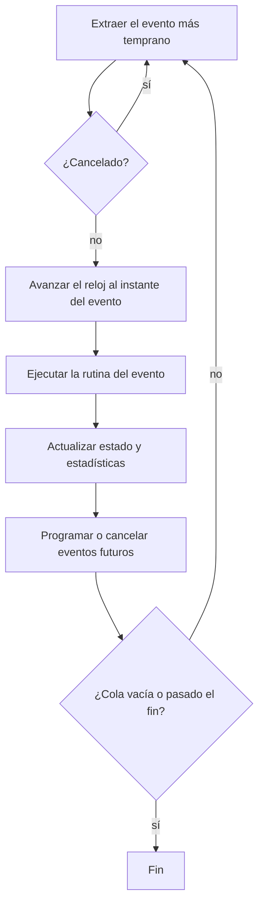

🌐 [[T02 Discrete-Event Simulation|EN]] · **ES** · [[T02 Ereignisdiskrete Simulation|DE]] · [[Inicio (ES)|Índice]]

# T02 Simulación de eventos discretos

## 1. Vocabulario

| Término                  | Definición                                        | En IntraCraft                                                                  |
| ------------------------ | ------------------------------------------------- | ------------------------------------------------------------------------------ |
| Entidad                  | Objeto que fluye por el sistema                   | Pallet                                                                         |
| Recurso / servidor       | Objeto que las entidades ocupan o esperan         | Zona de transportador, giratoria, transferencia                                |
| Atributo                 | Propiedad de una entidad                          | Tipo de pallet, masa, altura de carga, clave–valor                             |
| Variable de estado       | Valor que describe el sistema en el instante *t*  | Zona ocupada, tope arriba, motor en marcha                                     |
| Evento                   | Instante en el que cambia el estado               | `front_reaches_stop`, `sensor_edge`, `turn_completed`                          |
| Actividad                | Intervalo entre dos eventos con duración conocida | Girar 90° (6,5 s), subir cadenas (1 s)                                         |
| Reloj de simulación      | Tiempo simulado actual                            | Enteros en microsegundos (ver [[T03 Tiempo, orden de eventos y determinismo]]) |
| Lista de eventos futuros | Conjunto ordenado de eventos programados          | Montículo binario `EventQueue`                                                 |

## 2. Avance al siguiente evento

El núcleo de cualquier motor DES es un bucle que toma una y otra vez el evento programado **más temprano**, mueve el reloj a su instante y ejecuta su **rutina de evento**. La rutina actualiza el estado y puede programar eventos nuevos o cancelar otros.

```text
reloj ← 0
programar eventos iniciales (generadores, arranque del controlador)
mientras la lista no esté vacía y siguiente.tiempo ≤ fin:
    e ← lista.extraerMinimo()          # por (tiempo, prioridad, secuencia)
    si e fue cancelado: continuar      # predicción obsoleta
    reloj ← e.tiempo
    manejador[e.tipo](e)               # actualiza estado, programa/cancela
    registrar e                        # traza → estadísticas, hash
```



El reloj nunca avanza a pasitos: si el siguiente evento está en 12,25 s, el reloj pasa de 0 a 12,25 s en una sola asignación. Por eso el tiempo simulado no depende del tiempo de cálculo.

## 3. Visiones del mundo

Tres formas clásicas de escribir modelos DES:

1. **Programación de eventos** — una rutina por tipo de evento (lo que hacemos).
2. **Exploración de actividades** — se escriben condiciones y el motor las revisa todas tras cada evento.
3. **Interacción de procesos** — cada entidad es un proceso que «espera» (corrutinas); habitual en herramientas comerciales.

IntraCraft usa **programación de eventos organizada por componente**: cada comportamiento de la librería (p. ej. `des.roller_conveyor`) atiende los eventos dirigidos a él. El controlador Si/Entonces es una forma ligera de exploración de actividades que solo se reevalúa cuando cambia una señal ([[T07 Lógica de control y señales]]).

## 4. Transportadores como pistas: predecir en lugar de dar pasos

Un transportador se modela como una **pista** (coordenada 1D $s$ en el sentido del avance) con una lista ordenada de pallets. Cada pallet es un intervalo $[s_{cola}, s_{frente}]$ y tiene un **segmento cinemático** actual $(t_0, s_0, v_0, a)$:

$$s(t) = s_0 + v_0 (t - t_0) + \tfrac{1}{2} a (t - t_0)^2$$

Tras cada evento el motor **predice** el siguiente cruce interesante de cada pallet afectado resolviendo esa ecuación de segundo grado para $s(t) = s^\*$: la posición de un sensor, un tope, el final de una zona o la cola del pallet de delante menos la separación mínima ([[T04 Cinemática de transportadores]], función `timeToReach`). Solo se programa el cruce más temprano.

### Predicciones obsoletas

Una predicción deja de valer si algo cambia antes de que ocurra: sube un tope, se para un motor, frena el pallet de delante. Hay dos técnicas equivalentes:

- **Tiques de cancelación** (implementado en `DesSimulator.cancel`): se guarda el tique de cada predicción y se cancela; la cola lo descarta al extraerlo.
- **Números de versión** (previsto por pallet): cada pallet lleva una versión que aumenta cuando cambia su movimiento; un evento con una versión distinta de la actual se ignora.

Ambas evitan el coste de borrar un elemento cualquiera de un montículo.

## 5. Ejemplo: un pallet en una mesa de rodillos de 3 m con un sensor

| t (s)  | Evento                 | Qué hace la rutina                                                              |
| ------ | ---------------------- | ------------------------------------------------------------------------------- |
| 0,000  | `pallet_enters`        | Segmento $(0, 0, 0, 0{,}5)$; predice fin de rampa y cruce del sensor            |
| 0,500  | `ramp_ends`            | Nuevo segmento con $v = 0{,}25$ m/s, $a = 0$                                    |
| 8,250  | `sensor_edge` (subida) | Frente en 2,0 m: $t = 0{,}5 + (2{,}0 - 0{,}0625)/0{,}25$; señal → controlador   |
| 12,250 | `front_reaches_end`    | Entrega al siguiente transportador por el puerto B (T1)                         |
| 13,050 | `sensor_edge` (bajada) | La cola pasa por 2,0 m (frente en 3,2 m): largo / v = 4,8 s tras la subida (T6) |

Cinco eventos en lugar de miles de pasos. El visor anima el pallet entre eventos evaluando $s(t)$ en cada fotograma: «interpolación analítica».

## 6. Eventos simultáneos

Dos eventos pueden coincidir en el tiempo (dos pallets liberados por la misma regla). Entonces el orden importa: ¿se procesa el flanco del sensor antes de que reaccione el controlador? IntraCraft desempata con una **prioridad** explícita y después con la **secuencia de inserción**, lo que hace el resultado reproducible. Ver [[T03 Tiempo, orden de eventos y determinismo]].

## 7. Tipos de evento previstos en el MVP

`pallet_enters`, `front_reaches_stop`, `tail_clears_entry`, `sensor_edge`, `zone_released`, `turn_completed`, `lift_completed`, `transfer_completed`, `signal_changed`, `rule_fired`.

## 8. Coste

Cada evento cuesta $O(\log n)$ en el montículo más el trabajo de la rutina. Un estudio de rendimiento de horas de planta solo necesita segundos de cálculo; el objetivo es ≥ 1000× el tiempo real con 50 objetos y 30 pallets.

## Relacionado

[[T03 Tiempo, orden de eventos y determinismo]] · [[T04 Cinemática de transportadores]] · [[T05 Acumulación, capacidad y rendimiento]] · [[A06 Motor discreto]]
