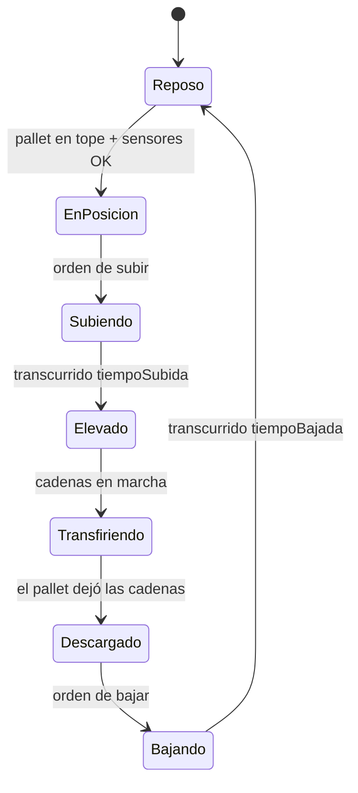

🌐 [[T07 Control Logic and Signals|EN]] · **ES** · [[T07 Steuerungslogik und Signale|DE]] · [[Inicio (ES)|Índice]]

# T07 Lógica de control y señales

## 1. Planta y controlador

Una instalación de transporte tiene una **planta** (mecánica: transportadores, topes, sensores) y un **controlador** (en la realidad, un PLC). Solo se comunican mediante **señales**:

- **Entradas al controlador** = salidas de sensores: `pe1`, `zone2.occupied`, `turntable.atStation`…
- **Salidas del controlador** = órdenes a actuadores: `zone1.run`, `stop1.up`, `turntable.goToStation`, `transfer.liftChains`…

IntraCraft mantiene esta separación de forma estricta: el mismo controlador manda la planta 2D y la planta 3D. Es lo que da sentido a comparar 2D y 3D y es la base de la *puesta en marcha virtual*.

## 2. Señales booleanas y flancos

Las señales del MVP son booleanas. La lógica a menudo no depende del valor sino de su **cambio**:

| Flanco | Definición                       | Uso típico                                                      |
| ------ | -------------------------------- | --------------------------------------------------------------- |
| Subida | anterior = falso, ahora = verdad | «Ha llegado un pallet al sensor»                                |
| Bajada | anterior = verdad, ahora = falso | «La cola del pallet ha dejado el sensor» → liberar el siguiente |

Un flanco solo existe en una evaluación; un nivel (`is: true`) se mantiene mientras se mantenga el valor.

## 3. Reglas Si/Entonces

Una regla es `CUANDO todas las condiciones ENTONCES escribir señales (opcionalmente tras un retardo)`:

```json
{
  "id": "stop-up-after-pass",
  "when": [{ "signal": "pe1", "edge": "falling" }],
  "then": [{ "signal": "stop1.up", "value": true, "delayMs": 200 }]
}
```

El evaluador (`packages/control/src/rules.ts`) es una **función pura**: `evaluateRules(reglas, anterior, actual) → escrituras`. Nunca lee un reloj ni toca la planta; quien lo llama aplica las escrituras y programa los retardos. Esa pureza es lo que permite que los dos modos lo compartan.

### Retardos y temporizadores

`delayMs` es el temporizador del MVP: la escritura se aplica más tarde. En 2D el retardo se convierte en un evento `signal_changed` programado en `ahora + retardo`; en 3D, en una escritura pendiente que se aplica en el primer ciclo de control ≥ ese instante. (Queda por especificar si una escritura retardada se cancela cuando desaparece la condición, como un temporizador a la conexión.)

## 4. ¿Cuándo se evalúan las reglas?

| Modo | Evaluación                                                | Consecuencia                                                                  |
| ---- | --------------------------------------------------------- | ----------------------------------------------------------------------------- |
| 2D   | Cada vez que cambia una señal (por eventos)               | Instantes de flanco exactos; sin retardo de muestreo                          |
| 3D   | En cada ciclo de control (10 ms por defecto), como un PLC | Hasta 10 ms de retardo extra; flancos más cortos que un ciclo pueden perderse |

Un PLC ejecuta un **ciclo de scan**: leer todas las entradas → ejecutar la lógica → escribir todas las salidas. El modo 3D lo reproduce. En 2D, evaluar en cada cambio equivale a un PLC infinitamente rápido; si un escenario depende del tiempo de ciclo, el modo 2D también puede configurarse para evaluar en una rejilla de 10 ms.

**Trampa — pulsos más cortos que el ciclo.** Un flanco de bajada seguido de uno de subida en menos de 10 ms es invisible para un controlador 3D pero visible en 2D. Mejor usar filtros en los sensores ([[T06 Detección fotoeléctrica]]) que depender de pulsos muy cortos.

## 5. Enclavamientos (interlocks)

Un **enclavamiento** es una condición que debe cumplirse antes de permitir una acción, pidan lo que pidan las reglas. Protegen equipos y pallets:

- Giratoria: no girar si el pallet no está centrado (`requiresCenteredPallet`) o si hay un pallet a caballo del borde.
- Transferencia: no subir sin pallet en posición; rodillos parados mientras las cadenas están arriba; no bajar hasta que el pallet haya dejado las cadenas; en modo bidireccional nunca aceptar por los dos lados.

Los enclavamientos viven **dentro del comportamiento del componente**, no en las reglas del usuario, para que una regla equivocada no pueda romper el modelo del equipo. Una orden bloqueada se registra como aviso.

## 6. Máquinas de estados

Los componentes complejos se secuencian como máquinas de estados finitos. Mesa de transferencia:



En 2D cada transición con duración conocida es un evento programado (`lift_completed` tras `liftTime`); en 3D las mismas transiciones se disparan cuando las cadenas cinemáticas llegan a sus posiciones objetivo.

## 7. Plantillas de control incluidas en el MVP

| Plantilla                            | Lógica en palabras                                                                     |
| ------------------------------------ | -------------------------------------------------------------------------------------- |
| Acumulación sin presión (ZPA)        | La zona *i* marcha mientras la *i+1* esté libre; se detiene si ambas están ocupadas    |
| Tope con sensor                      | Tope arriba por defecto; bajar cuando aguas abajo esté libre; subir tras pasar la cola |
| Giratoria que espera pallet centrado | Recibir → si está centrado: parar cadenas → girar → asentar → descargar                |
| Transferencia con secuencia completa | Máquina de estados del §6 con todos los enclavamientos                                 |

La plantilla ZPA está probada en `control/src/rules.test.ts`.

## Relacionado

[[T05 Acumulación, capacidad y rendimiento]] · [[T13 Giratorias y mesas de transferencia]] · [[A08 Controlador]]
